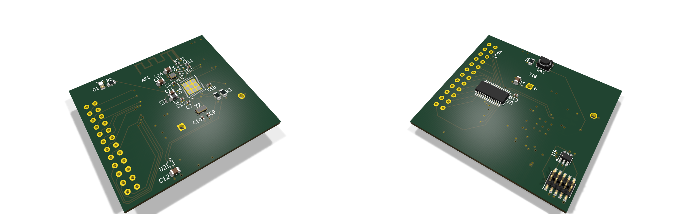

# nRF52 温湿度传感器 · 四层 PCB 硬件工程

基于 **nRF52810** 的低功耗 BLE 温湿度传感器：CR2032 纽扣电池直接供电，SHT40 采集温湿度，HT16C21A 驱动段码 LCD 常显，板载 2.4 GHz PCB 天线对外广播。

工程从需求分析、原理图、四层 PCB 布局布线，做到电源仿真、信号／电源完整性分析、热设计、DFM 整改与生产文件交付，完整走完一遍从需求到制造文件的硬件设计流程。

> **本工程只做设计、仿真与可制造性分析，未提交订单、未产生实际支付。**
> 文档中出现的板厂报价截图均为下单页快照，用于比较工艺选项的成本，不代表已下单。



---

## 关键指标

| 项目 | 参数 |
|---|---|
| 板框尺寸 | 48.25 × 40.05 mm |
| 层数 / 叠层 | 4 层，S-G-P-S（信号-地-电源-信号） |
| 板厚 | 1.6062 mm（成品 1.6 mm 级） |
| 主控 | nRF52810 QFN48，0.4 mm 间距 |
| 传感器 | SHT40（I²C，±1.8 %RH / ±0.2 °C） |
| 显示 | HT16C21A + 20×4 段码 LCD |
| 供电 | CR2032 3.0 V 直供，不经 LDO |
| 无线 | 2.4 GHz 板载 PCB 天线，50 Ω 馈线 W ≈ 0.36 mm |
| I²C | 100 kHz，10 kΩ 上拉 |
| 低电量阈值 | 2.8 V 告警；系统工作下限 2.4 V |
| BOM | 23 行 / 31 个位号，标准带屏版约 28.36 元 |
| DRC | 0 error、0 未连接 |

---

## 系统组成

```
        ┌──────────┐   I²C    ┌────────────┐
 CR2032 ─┤ SHT40    ├──────────┤ nRF52810   ├── SWD ── J1（U4 ESD 保护）
  3.0 V  └──────────┘          │            │
                              │            ├── 2.4 GHz PCB 天线
                     I²C      │            │
        ┌────────────┐        │            │
        │ HT16C21A   ├────────┴────────────┘
        │     ↓      │
        │  段码 LCD  │
        └────────────┘
```

三条路径：**数据**（SHT40 → nRF52810 → 段码 LCD、天线）、**供电**（CR2032 直供三个模块）、**调试**（SWD 三线，入口处 U4 做 ESD 保护）。

---

## 目录结构

```
.
├── hardware/          KiCad 10 工程、自定义符号与封装、ERC/DRC 报告
├── simulation/        LTspice 电源仿真电路与运行日志
├── manufacturing/     生产文件包（Gerber、钻孔、BOM、CPL、制板说明）
├── docs/              8 周实验报告与各专项设计说明（Markdown）
├── presentation/      项目演示 PPT（含逐页讲解录音）、PDF 与讲解稿
└── images/            3D 图、系统框图、流程框图、关键布局图
```

各目录下的文件命名即对应周次与主题，`docs/wk1` … `docs/wk8` 按八周实验顺序排列。

---

## 设计要点

**叠层与阻抗** — 采用 S-G-P-S 四层结构。顶层射频馈线以下方地平面（In1.GND）为参考，按介质厚度 0.2104 mm、Er ≈ 4.4 反算 50 Ω 对应线宽约 0.36 mm；QFN 引脚出口受焊盘间距限制，局部采用约 0.7 mm 的短颈缩，其余馈线保持顶层连续、避免过孔。

**布局分区** — 射频链路单独占一角并保持参考地完整；SHT40 布置在板边、与主控中心距离约 25.5 mm，器件下方设置四层禁铜区，降低板内热耦合；晶振与负载电容贴近对应引脚，去耦电容结合电源引脚布置。

**电源完整性** — CR2032 直供省掉 LDO 压差损失。LTspice 中以电压源＋电池内阻＋等效脉冲负载＋去耦电容建模，扫描 10 / 30 / 50 Ω 三档内阻，最低电压约 2.499 V；PCB 自身压降小于 0.5 mV，电压波动主要来自电池内阻。

**接口与防护** — I²C 综合驱动供电条件采用 100 kHz，按约 30 pF 总线电容估算上升时间约 254 ns；SHT40 与 HT16C21A 地址不冲突，共用一路总线。SWD 入口 U4 在保护性能与低功耗之间取舍，重点控制漏电流。

**可制造性** — DRC 收口到 0 error、0 未连接；DFM 报出的 96 条危险按封装模型差异、贴装方向与盘中孔工艺逐条分类核对，U1 散热盘盘中孔在制板说明中明确采用 POFV 工艺（IPC-4761 Type VII）。

---

## 工具

| 环节 | 工具 |
|---|---|
| 原理图 / PCB | KiCad 10.0 |
| 电源仿真 | LTspice |
| 阻抗计算 | 板厂阻抗计算器 + 手工反算交叉验证 |
| 可制造性 | 板厂 DRC / DFM 分析 + 人工逐条核对 |

---

## 文档索引

| 文档 | 内容 |
|---|---|
| [`docs/项目理解与个人8周计划`](docs/项目理解与个人8周计划.md) | 项目理解与八周安排 |
| [`docs/变更记录表_智能温湿度传感器`](docs/变更记录表_智能温湿度传感器.md) | 全流程变更与决策记录 |
| [`docs/wk1`](docs/wk1) | 产品需求分析、引脚分配 |
| [`docs/wk2`](docs/wk2) | 器件选型、符号库、LTspice 入门 |
| [`docs/wk3`](docs/wk3) | 四层叠层设计与阻抗计算 |
| [`docs/wk4`](docs/wk4) | 布局布线 |
| [`docs/wk5`](docs/wk5) | DRC、ESD 与滤波、电源模块布线 |
| [`docs/wk6`](docs/wk6) | 信号完整性、电源完整性、热设计、DFT |
| [`docs/wk7`](docs/wk7) | DFM、BOM 与工艺、生产文件包清单、贴装方向说明 |
| [`docs/wk8`](docs/wk8) | 项目总结报告、交付确认说明 |
| [`presentation/项目演示PPT_讲解稿`](presentation/项目演示PPT_讲解稿.md) | 22 页演示的逐页讲稿 |

---

## 说明

- 本工程为个人学习过程中的完整硬件设计练习，器件选型、参数取值与工艺决策均在文档中给出依据。
- 板厂报价与工艺选项以截图形式记录，仅用于说明取舍过程。
- 演示录像体积较大，未随仓库提供。
