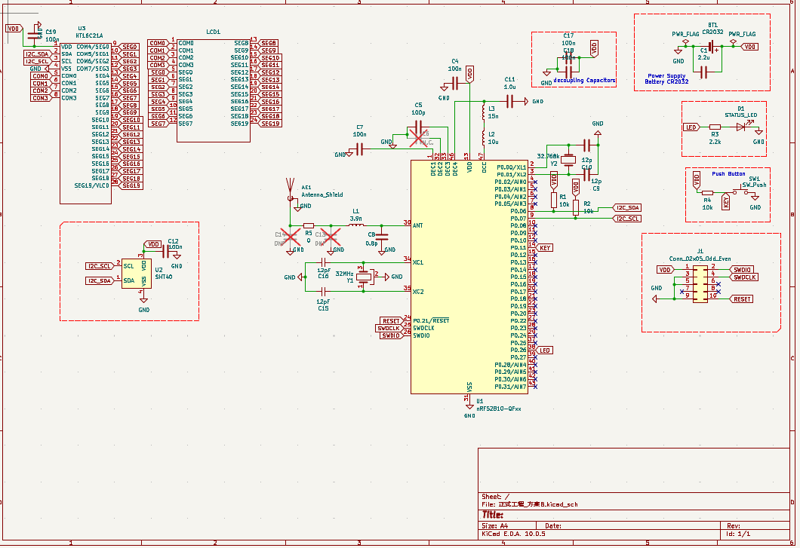
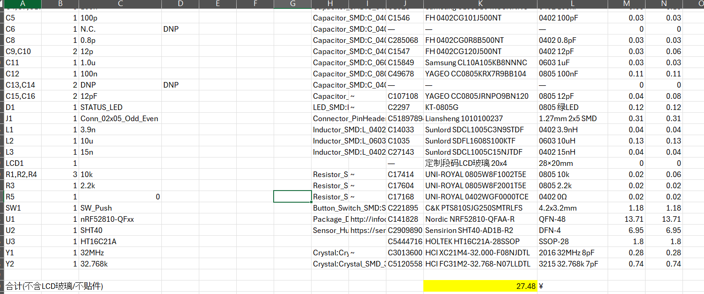

# 开源智能温湿度传感器 Pro PCB 设计——第 2 周实验报告

> 姓名：谢天成  
> 项目周期：第 2 周（2026.08.31—2026.09.06）  
> 本周阶段：系统框图、正式原理图、封装解决、LTspice 电源仿真与 BOM

---

## 1. 本周目标

本周是设计前端的关键一周，目标是把方案落地为一张**过 ERC 的正式原理图**，并同步完成电源仿真与 BOM 成本评估，为第 3 周进入布局布线做好准备。具体包括：

- 完成系统框图和正式原理图（含 nRF52810、SHT40、HT16C21A LCD 驱动、段码屏、CR2032 供电及射频/晶振网络）。
- 解决 LCD 段码玻璃和 HT16C21A（28-SSOP）两处尚无现成封装的难点。
- 让原理图通过 ERC 电气规则检查。
- 用 LTspice 对 CR2032 供电轨做瞬态仿真，验证去耦电容与内阻对压降的影响。
- 导出正式 BOM 并从 LCSC 补齐具体型号与价格，锁定最终成本。

## 2. 本周完成情况

### 2.1 系统框图与正式原理图

- 按方案 B（标准带屏版）搭建正式工程，梳理出完整的电源-信号架构：CR2032 3V → 去耦电容组 → 三路负载（nRF52810 主控、SHT40 传感器、HT16C21A LCD 驱动）。
- 完成正式原理图的主要模块连接，包括 nRF52810 QFN48、SHT40、HT16C21A、段码 LCD、按键、状态 LED、SWD 调试接口、32 MHz 与 32.768 kHz 晶振及射频匹配网络。
- 从网表反向核对确认了电源架构细节：VDD 轨上共 6 个去耦电容（1 个 2.2 µF + 5 个 100 nF），整板电容总数 14 个，负载为 3 个 IC。

### 2.2 封装解决（HT16C21A 与 LCD 段码玻璃）

- **HT16C21A（28-SSOP）**：核对 Holtek 数据手册第 34 页封装尺寸表后，锁定 KiCad 标准库精确匹配封装 `Package_SO:SSOP-28_3.9x9.9mm_P0.635mm`，并修正了此前 5.3 mm 宽的错误记录。
- **LCD 段码玻璃**：因 20×4 段码玻璃无标准封装，编写了《HT16C21A_KiCad_symbol 创建指南》，覆盖自定义符号与 Footprint Editor 建库全流程；玻璃本体暂以 1×24 排针占位，待评审确认后再替换为自定义封装。

### 2.3 ERC 检查与整改

- 定位并解决了一类"视觉上已连接、ERC 却报未连接"的问题：HT16C21A 的 SEG9 引脚与 LCD 符号的 SEG16–SEG19 共 5 个引脚被放在 50 mil 网格之外（偏移约 0.05 mm），导致导线和网络标签无法真正接触引脚。将引脚移回网格后，ERC 通过。

### 2.4 LTspice 电源仿真

- 建立 CR2032 供电轨瞬态模型：3 V 电池串内阻 Rb、6 个去耦电容、3 个电流源分别建模三路负载。
- 负载电流值以器件数据手册为依据、部分向上取整为保守值：nRF52810 0 dBm 发射约 4.6 mA（叠加 CPU 与 LED 后取 10 mA 峰值）、SHT40 测量态 0.6 mA、HT16C21A 约 18 µA。
- 用 `.step` 扫描 Rb = 10 / 30 / 50 Ω 三种内阻，完成 0–2 s 瞬态仿真，并解决了电流源悬浮节点、文本窗口无法仿真、空白波形窗口等操作问题。
- 仿真结论：最差（Rb = 50 Ω）时 VDD 最低跌至约 2.5 V，仍高于 nRF52810 的 1.7 V 欠压线 0.8 V，CR2032 直供余量充足。
- 输出《LTspice 电源仿真_教程》和《电源 ltspice 仿真.docx》两份文档。

### 2.5 BOM 导出与 LCSC 定价

- 导出正式 BOM，新增 5 列（LCSC 编号、厂家型号、封装、单价¥、小计¥），逐一从 LCSC 补齐全器件型号与价格。
- 关键器件：nRF52810-QFAA-R ¥13.71、SHT40-AD1B-R2 ¥6.95、HT16C21A ¥1.80、电池座 ¥1.35、按键 ¥1.18、32 MHz 晶振 ¥0.28、32.768 kHz 晶振 ¥0.74、10 µH 电感 ¥0.13。
- BOM 合计 **¥27.48**（不含段码玻璃及 DNP 器件），该成本口径已经评审确认通过。

## 3. 本周遇到的问题及处理

| 问题 | 处理情况 |
|---|---|
| HT16C21A 封装名一开始写成 5.3 mm 宽的错误型号 | 核对数据手册第 34 页尺寸表，修正为 `SSOP-28_3.9x9.9mm_P0.635mm` |
| ERC 报多个引脚"未连接"，但视觉上已连上 | 发现 5 个引脚被放在 50 mil 网格之外（偏移约 0.05 mm），移回网格后连接恢复 |
| LCD 段码玻璃无标准封装 | 编写自定义符号/封装创建指南，玻璃暂用 1×24 排针占位待确认 |
| LTspice 点击仿真无反应 | `.cir` 中混入中文/全角字符（—、Ω）且以文本窗口打开；重写为纯 ASCII 并改用 Simulate→Run 菜单 |
| LTspice 报"Node floating connected to current source" | 2 个电流源的悬浮端未接地；为三个电流源各自独立接地后消除 |
| LTspice 跑完但无波形 | 空白波形窗口属正常现象；需点击导线（电压探针）或 Add Trace 添加曲线 |
| BOM 合计 ¥27.48 高于最初 15 元的预估 | 其中 nRF52810 + SHT40 两颗核心器件即 ¥20.66；已评审确认，现方案约 27 元的成本口径通过 |

## 4. 当前进度评估

第 2 周计划中的系统框图、正式原理图、封装解决、ERC 检查、LTspice 电源仿真与 BOM 导出均已基本完成，原理图已通过 ERC，仿真也给出了正面的供电结论。

成本方面，BOM 合计 ¥27.48，其中 nRF52810（¥13.71）与 SHT40（¥6.95）两颗核心器件即占 ¥20.66。这一结果高于最初 15 元的预估，但**现方案约 27 元的成本口径已经评审确认通过**，不再作为风险项。整个设计前端（方案 + 原理图 + 仿真 + BOM）至此闭环。

整体进度符合计划，工程层面已具备进入第 3 周布局布线的条件；主要待决事项是 **LCD 段码玻璃的最终封装**。

## 5. 下周计划

1. 确定段码 LCD 玻璃的最终封装并替换 1×24 排针占位。
2. 完成 4 层板叠层设计（信号-地-电源-信号），并锁定嘉立创介质厚度、铜厚与阻抗计算参数。
3. 绘制板框（36 mm × 36 mm），完成器件布局与电源/地平面分割。
4. 学习叠层与参考平面、回流路径与布局原则等理论，输出叠层文档与理论笔记。

## 6. 本周总结

本周完成了从方案到正式原理图的落地，攻克了 HT16C21A 与段码玻璃两处封装难点，定位并解决了 ERC 离格引脚这类隐蔽问题，并用 LTspice 量化验证了 CR2032 直供方案的供电余量。通过网表反向核对和 LCSC 逐项定价，BOM 也完成了逐项定价，最终约 27 元的成本口径已经评审确认，设计前端（方案 + 原理图 + 仿真 + BOM）就此闭环。下一阶段将正式进入 4 层板布局布线，重点是把第 1–2 周定下的方案在叠层、布局和电源分割上落到实处。
