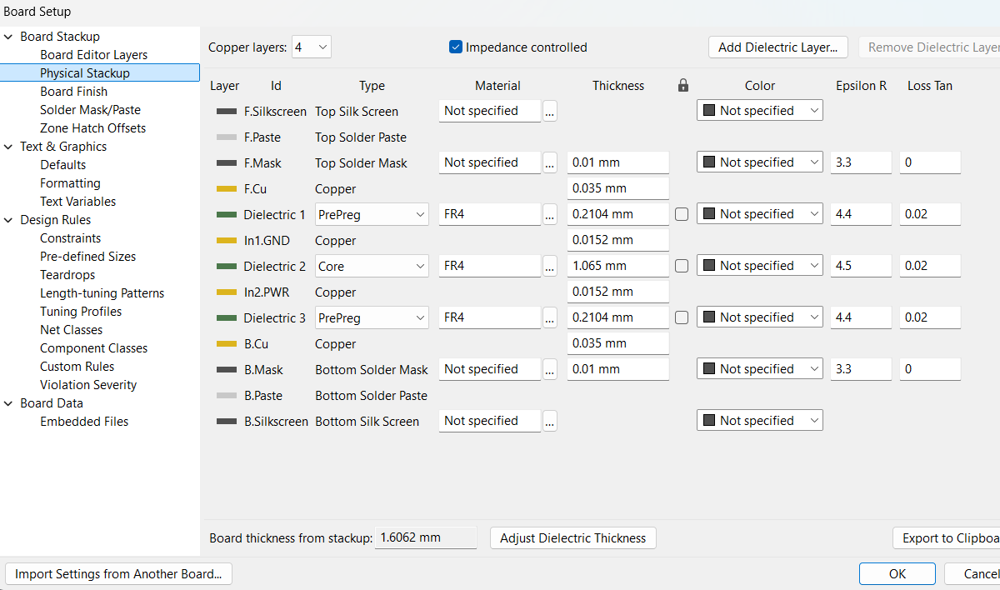
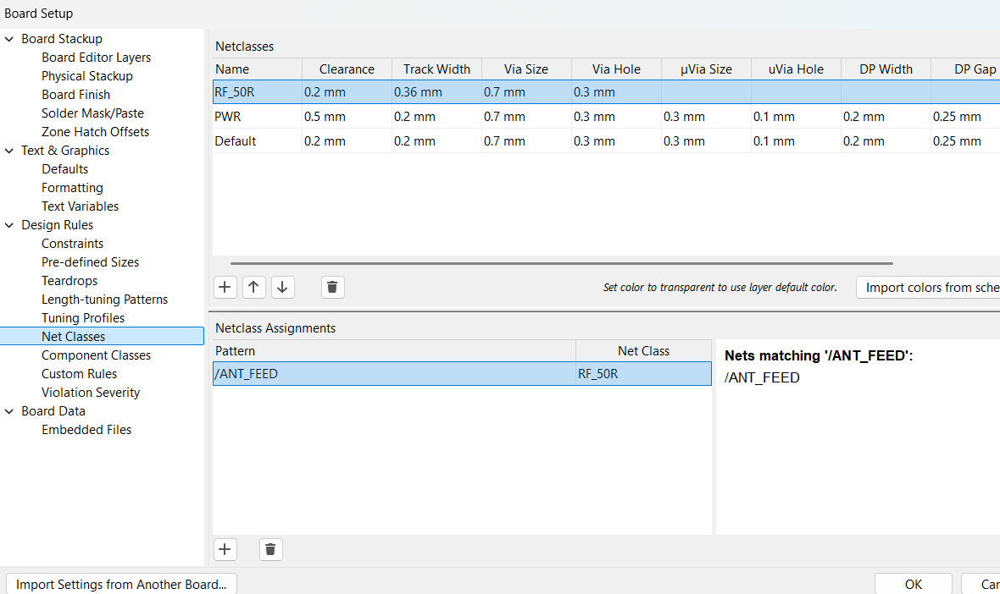

# 开源智能温湿度传感器 Pro PCB 设计——第 3 周实验报告

> 姓名：谢天成  
> 项目周期：第 3 周（2026.09.07—2026.09.13）  
> 本周阶段：四层板叠层设计、50Ω 阻抗计算与 KiCad 规则落地

---

## 1. 本周目标

本周正式从"方案"转入"板级设计"，核心是把第 1–2 周定下的方案在叠层和阻抗层面落到实处。具体包括：

- 学透四层板叠层设计原理，明确 S-G-P-S 层序选择的依据。
- 结合嘉立创标准四层板工艺，锁定本项目的叠层结构、各层铜厚与关键介质厚度。
- 用嘉立创阻抗计算器算出 50Ω 微带线的线宽，作为射频馈线的布线约束。
- 在 KiCad 中完成物理叠层设置与 50Ω 网络类，为第 4 周布局布线打好规则基础。

## 2. 本周完成情况

### 2.1 四层板叠层理论学习

- 系统学习了 PCB 叠层的基本概念：Core（芯板）与 Prepreg（半固化片）的区别、参考平面（Reference Plane）、回流路径、以及叠层对称与板翘曲的关系。
- 对比了二层板与四层板在完整地平面、电源平面、射频 50Ω 控制上的差异，确认本项目因含 nRF52810 蓝牙射频，必须采用四层板。
- 对比了 S-G-P-S、G-S-S-P、S-S-G-P 三种常见四层叠层方案，最终选定 **S-G-P-S（信号-地-电源-信号）**：顶层射频/晶振紧贴完整地平面，底层 I2C 紧贴电源平面，两个信号层各自都有完整参考平面。
- 整理输出《PCB四层板叠层设计教学.md》，含概念讲解、嘉立创标准叠层参数表和 B 站教程清单。

### 2.2 本项目叠层方案定稿

- 结合嘉立创 1.6 mm 标准四层板工艺，锁定本项目叠层结构：

| 层 | 层名（KiCad） | 铜/介质 | 厚度 | 用途 |
|---|---|---|---|---|
| L1 | F.Cu（Top） | 外层 **1 oz** 铜 | 0.035 mm | 主信号层：射频、晶振、主控、传感器 |
| — | Prepreg（7628 RC49%） | FR-4，Er ≈ 4.4 | 0.2104 mm | Top→GND 介质（阻抗关键值 H） |
| L2 | In1.GND | 内层 **0.5 oz** 铜（H/HOZ） | **0.0152 mm** | 完整地平面 |
| — | Core（1.1 mm H/HOZ） | FR-4，Er ≈ 4.5 | 1.065 mm | 中间芯板 |
| L3 | In2.PWR | 内层 **0.5 oz** 铜（H/HOZ） | **0.0152 mm** | 3V 电源平面（VDD） |
| — | Prepreg（7628 RC49%） | FR-4，Er ≈ 4.4 | 0.2104 mm | Bottom→PWR 介质 |
| L4 | B.Cu（Bottom） | 外层 **1 oz** 铜 | 0.035 mm | 副信号层：I2C、调试、电池、按键 |
| **合计** | | | **1.606 mm**（嘉立创标称 1.59 mm ±10%） | |

> 铜厚要点：嘉立创标准四层板的铜厚是**外层 1 oz、内层 0.5 oz**（芯板规格标为 H/HOZ），并非四层都是 1 oz，填叠层时内外层要分开填。内层铜厚偏薄不影响 50Ω 计算（参考平面的电流集中在朝向走线的表面，平面自身厚度基本不参与），本项目 CR2032 供电电流很小，0.5 oz 的电源平面压降也完全够用。

- 明确了各层信号分配：射频链路、32 MHz 晶振、SHT40 及去耦电容放在 Top；I2C、SWD、32.768 kHz 晶振、电池座与按键放在 Bottom；GND 与 PWR 均为整层连续平面（本项目为 CR2032 单一 3V 供电，PWR 无需分割）。
- 输出《本项目叠层方案_智能温湿度传感器_4层板.md》作为叠层方案归档。

### 2.3 KiCad 物理叠层设置

- 在 KiCad 的 `文件 → 板设置 → 物理叠层` 中，将层数从默认双层改为 4 层，按上述表格逐层填入铜厚（**外层 1 oz = 0.035 mm，内层 0.5 oz = 0.0152 mm**）、介质类型与厚度（PrePreg 0.2104 mm / Core 1.065 mm）、介电常数（PP ≈ 4.4、Core ≈ 4.5），并命名 `F.Cu / In1.GND / In2.PWR / B.Cu`，同时勾选 **Impedance controlled（阻抗控制）**。叠层合计厚度显示为 **1.6062 mm**，与嘉立创标称 1.59 mm 一致。
- 在 Edge.Cuts 层绘制了 **40 mm × 40 mm** 的板框。

### 2.4 50Ω 阻抗计算

- 用嘉立创阻抗计算器（选用 `JLC04161H-7628` 通用叠层模板，成品板厚 1.59 mm ±10%）代入本项目关键参数：介质厚度 **H = 0.2104 mm**（Top→GND 的 PP 厚）、FR-4 介电常数 **Er ≈ 4.4**、走线铜厚 1 oz（外层）、目标阻抗 **50Ω**（阻值公差填 0.5），反算得到射频微带线线宽 **W = 14.1 mil ≈ 0.36 mm**，对应反算阻值 **49.84Ω**，落在公差内。
- 确认下单时需勾选「阻抗控制」，将「顶层单端 50Ω」写入工艺要求，由板厂按 ±10% 修正。

### 2.5 KiCad 网络类约束

- 在 KiCad 的 `设计规则 → 网络类` 中新建 **`RF_50R`** 网络类（线宽 0.36 mm、安全间距 0.2 mm、过孔 0.7/0.3 mm），把射频馈线网络 **`/ANT_FEED`** 分配到该类，布线时自动约束射频走线宽度；其余信号仍走 `Default` 类（0.2 mm），电源另建 `PWR` 类（间距 0.5 mm）。
- 同步梳理了天线净空区（keepout）与地过孔缝合策略，作为下一周布局布线时的规则前提。

## 3. 本周遇到的问题及处理

| 问题 | 处理情况 |
|---|---|
| 不清楚四层板与二层板在阻抗/EMI 上的本质区别 | 系统学习叠层与回流路径理论，明确"完整地平面 + 关键信号紧邻参考平面"是选四层板的核心原因 |
| 对 Core 与 Prepreg 的厚度关系不清晰 | 对照嘉立创标准叠层表，锁定 Top→GND 的 PP 厚 = 0.2104 mm（7628 RC49%）作为 50Ω 计算的输入 H |
| 原以为四层板各层铜厚都是 1 oz | 查嘉立创标准叠层，四层板为**外层 1 oz / 内层 0.5 oz（H/HOZ）**，已在 KiCad 物理叠层中按 0.035 mm 与 0.0152 mm 分别填写，并核对叠层合计厚度 1.6062 mm 与标称 1.59 mm 相符 |
| 50Ω 线宽手算结果受板厂 PP 介电常数影响有偏差 | 以嘉立创阻抗计算器结果为准（W ≈ 0.36 mm），并在下单时勾选阻抗控制由板厂修正 |
| 担心默认双层模板直接画四层板导致阻抗计算失效 | 先在物理叠层中建好 4 层结构（含内外层铜厚区分），再画板框与布线，避免用双层模板硬画 |
| 射频走线宽度需与普通信号区分约束 | 在网络类中为射频网络单独建类并绑定 0.36 mm 线宽，普通信号仍走默认类 |

## 4. 当前进度评估

第 3 周计划中的四层板叠层理论学习、本项目叠层方案定稿、50Ω 阻抗计算、KiCad 物理叠层设置与网络类约束均已基本完成，并已完成 40 mm × 40 mm 板框绘制。叠层、板厚、50Ω 单端阻抗三个关键参数已具备评审确认的条件。

整体进度符合计划。设计工作已从第 1–2 周的"方案 + 原理图 + 仿真 + BOM"前端，正式推进到板级设计阶段；下一阶段的重点是按叠层方案完成布局、铺铜与地孔缝合。

## 5. 下周计划

1. 把叠层定稿结果（层序 + 板厚 + 50Ω 单端阻抗）评审确认一次，再进入布局布线。
2. 按叠层方案分层布局：主控、射频、晶振在 Top；I2C、调试、电池在 Bottom。
3. 完成 GND、PWR 铺铜，落实天线净空区与地过孔缝合。
4. 按优先级布线（射频 → 晶振 → 去耦 → I2C/GPIO），运行 DRC 并整改主要错误。

## 6. 本周总结

本周完成了从"方案"到"板级设计"的关键过渡：系统学习了四层板叠层与阻抗理论，选定了 S-G-P-S 层序，结合嘉立创标准工艺锁定了本项目的叠层结构（外层 1 oz / 内层 0.5 oz、PP 0.2104 mm、Core 1.065 mm，合计 1.606 mm）与介质厚度，用阻抗计算器算出了 50Ω 微带线线宽（14.1 mil ≈ 0.36 mm，反算 49.84Ω），并在 KiCad 中把物理叠层、40×40 mm 板框和 50Ω 网络类约束逐一落地。这些规则层面的准备，为下一周的布局布线铺平了道路，也把射频走线阻抗控制这一此前最大的经验短板，从"担心"变成了"有明确参数可依"。
