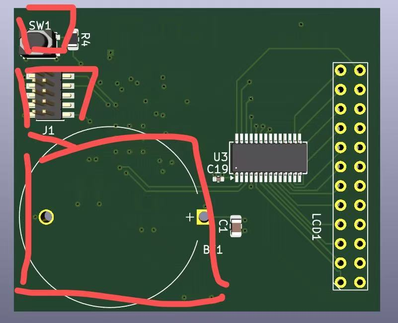
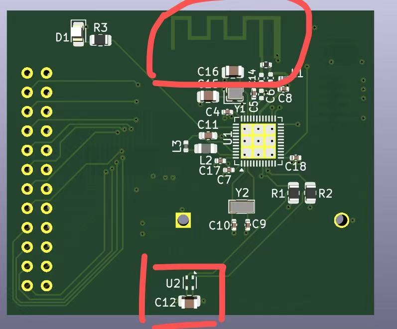

# ESD 与滤波设计说明

> 项目：开源智能温湿度传感器 Pro PCB 设计
> 姓名：谢天成
> 周次：第 5 周（2026.09.21—2026.09.27）
> 对应交付物：第 5 周交付物 ③ —— ESD 与滤波设计说明
> 本版依据设计文件、器件资料及工程估算修订，与《信号完整性分析》《电源完整性分析》的结论保持一致。

---

## 1. 说明目的与范围

本说明覆盖 **ESD（静电放电）防护**与**滤波设计**两部分：

1. 本板的 ESD 风险环境、各入口的泄放路径，以及已实施的防护措施；
2. 滤波网络的构成、元件取值依据及其在设计中的作用。

> 滤波特指**有意设计的频率选择性网络**；ESD 部分针对**可触及导体**逐点分析泄放路径。

---

# 第一部分：ESD 防护

## 2. ESD 环境评估

### 2.1 设备形态与可触及导体

ESD 的风险取决于**人体能否直接接触到与芯片相连的导体**。本板是 CR2032 纽扣电池供电的手持式设备，**没有任何外部线缆**，这一点显著降低了 ESD 风险等级——不存在市电设备或带 USB / 外接线设备那样的持续暴露导电路径。

| 位号 | 器件 | 层 | 所连网络 | 用户可触及性 |
|---|---|---|---|---|
| **BT1** | CR2032 电池座（金属夹片） | B.Cu | BT1.1 → VDD；BT1.2 → GND | ⚠️ **更换电池时手指直接接触** |
| **SW1** | PTS810 轻触按键 | B.Cu | SW1.1 → KEY；SW1.2 → GND | ✅ **正常使用时手指按压** |
| **J1** | 1.27 mm 2×5 调试座 | B.Cu | J1.1 → VDD；J1.2 → SWDIO；J1.4 → SWDCLK；J1.10 → nRESET；J1.3/5/9 → GND；J1.6/7/8 → NC | ⚠️ **裸露焊盘，即使不贴连接器焊盘仍然存在** |
| **AE1** | PCB 天线辐射体 | F.Cu | AE1.1 → ANT_FEED；AE1.2 → GND | ⚠️ 裸露铜皮，正常被外壳覆盖 |
| **U2** | SHT4x 传感器 | F.Cu | U2.1 → I2C_SDA；U2.2 → I2C_SCL；U2.3 → VDD；U2.4 → GND | ⚠️ 感湿开孔朝外，但 4 个引脚均在器件底部，人体无法直接接触 |

**B.Cu 侧（背面）可触及部分——SW1、J1、BT1：**



**F.Cu 侧（正面）可触及部分——AE1 天线辐射体、U2 传感器：**



### 2.2 各器件的 ESD 耐受能力

| 器件 | ESD HBM | ESD CDM | 其他 | 手册出处 |
|---|---|---|---|---|
| **U1 nRF52810** | **4 kV** | **1000 V** | MSL 2 | PS v1.1 表 108 绝对最大额定值 |
| **U2 SHT4x** | **2 kV** | **500 V** | 闩锁 JESD78 Class II @125 °C：**100 mA** | Datasheet v7.3 表 6 绝对最大额定值 |
| **U3 HT16C21A** | **未标注** | **未标注** | — | Datasheet v1.30 **全文未出现 "ESD" 字样** |

三者的耐受能力差别很大，**全板的薄弱环节是 U2（SHT4x）**——HBM 仅 2 kV / CDM 500 V，且 Sensirion 在手册中明确警告：

> *"The inherent design of this component causes it to be sensitive to electrostatic discharge (ESD). To prevent ESD-induced damage and/or degradation, take customary and statutory ESD precautions when handling this product."*
> —— SHT4x Datasheet v7.3，ESD Precautions 章节

U1（nRF52810）的 4 kV HBM 是三者中最高的。U3（HT16C21A）的手册未给出 ESD 指标，无法从数据手册确认其耐受水平，按"未知即从严对待"处理，但本板的防护措施不以 U3 为瓶颈。

### 2.3 各入口的泄放路径

**① SW1（按键）——防护最充分**

```
手指 → SW1 金属 → SW1.1 ──[ R4 · 10 kΩ ]──→ U1.14 (KEY)
                   SW1.2 ─────────────────→ GND
```

按键一端直接接 GND，另一端经 **R4 = 10 kΩ 串联**才到 MCU 引脚。以 IEC 61000-4-2 的 8 kV 接触放电（峰值电流约 30 A）计算，10 kΩ 把流入 U1.14 的峰值电流限制在 **0.8 A 以下**，远低于该引脚内部 ESD 钳位结构的承受能力。R4 同时是按键的上拉电阻，**没有额外成本**。

**② BT1（电池座）——风险最高的入口**

```
手指 → BT1 金属夹片 → BT1.1 ─────────────→ VDD（整条电源轨）
                       BT1.2 ─────────────→ GND
```

电池正极夹片直接连在 VDD 上，**中间没有任何串联限流元件**。一次放电会灌入整条 VDD 电源轨，全板所有芯片的 VDD 引脚同时承受；唯一能吸收能量的是 C1（2.2 µF），但 ESD 是纳秒级瞬变，体电容的等效串联电感限制了它在这么快的边沿上的作用。

本板对该入口采取的措施见 §3.3.5。

**③ J1（调试座）——开发阶段风险**

J1 的 10 个焊盘完全裸露，其中 **J1.1 直接连 VDD**，J1.2 / J1.4 / J1.10 直接连 SWDIO / SWDCLK / RESET，**均无限流**。缓解因素是 J1 只在调试阶段使用，量产版本可不贴连接器、整机封闭在外壳内——但**焊盘本身仍然裸露**，因此防护器件不能省略。措施见 §3.3。

**④ U2（传感器）——无直接导电路径**

U2 的感湿开孔朝外，器件本体暴露于空气，但 4 个引脚全部在器件底部，人体无法直接接触，ESD 只能通过空气放电间接耦合。此外 U2 的 I2C 两条线上各有一只 10 kΩ 上拉电阻（R1 / R2）连到 VDD，兼作节点电荷的泄放路径。

**⑤ AE1（天线）**

天线辐射体是裸露铜皮，其馈电点经 R5（0 Ω）、L1（3.9 nH）与 U1.30（ANT 脚）相连——**两者对直流都是导通的，因此天线节点与芯片之间没有直流隔离**。天线节点的 ESD 风险主要靠正常使用时被外壳覆盖来规避，不另加器件。

---

## 3. 防护措施

### 3.1 已有的措施（非专用器件）

| # | 措施 | 涉及器件 | 作用 |
|---|---|---|---|
| **1** | 按键串联 10 kΩ 限流 | R4 | 把按键入口的放电电流限制在 0.8 A 以下 |
| **2** | I2C 总线 10 kΩ 上拉 | R1 / R2 | 兼作传感器与总线节点的电荷泄放路径 |
| **3** | 电池入口体电容 2.2 µF | C1 | 吸收 VDD 轨上的能量，降低瞬变幅度 |
| **4** | 每个 IC 就近去耦 100 nF | C4 / C12 / C17 / C18 / C19 | 为局部电流尖峰提供就近回路 |
| **5** | **In1 完整地平面（距顶层仅 0.2104 mm）** | 叠层 | 提供**最低阻抗的泄放路径**——这是 ESD 防护中最基础的一条 |
| **6** | U1 散热焊盘 + 9 个过孔 | U1 EP | EP 兼为芯片的地连接，9 个过孔提供低阻抗接地 |
| **7** | 传感器下方四层 keepout | U2 内嵌 zone | 以热隔离为主，同时移除了传感器周边的铜，减少耦合路径 |

> ESD 防护的第一原则不是"加 TVS"，而是**让放电电流有一条低阻抗、短路径的回流通道**。本板 In1 为完整 GND 平面且距顶层仅 0.2104 mm，任何从顶层进入的放电电流都能在极短距离内找到地平面泄放；地平面若被分割或距离很远，放电电流会被迫绕行，沿途耦合到其他网络。本板的层叠（信号 → **地** → 电源 → 信号）本身就是一种有效的 ESD 结构。

### 3.2 J1 调试接口的防护方案

#### 3.2.1 保护对象

J1 共 10 个引脚，其中 4 条网络与芯片直连，构成 ESD 进入芯片的最短路径：

| J1 引脚 | 网络 | 连接对象 | 需保护 |
|---|---|---|---|
| 1 | VDD | 全板电源轨 | ✔ |
| 2 | SWDIO | U1.26 | ✔ |
| 4 | SWDCLK | U1.25 | ✔ |
| 10 | nRESET | U1.24 | ✔ |
| 3 / 5 / 9 | GND | — | 不适用 |
| 6 / 7 / 8 | 未连接 | — | — |

#### 3.2.2 方案与选型

**在 J1 处并联一颗多通道 ESD 保护阵列，各通道对 GND 钳位，器件紧贴 J1 焊盘放置。**

**选型指标**

| # | 指标 | 要求 | 依据 |
|---|---|---|---|
| 1 | 反向工作电压 V_RWM | **≥ 3.6 V** | 信号最高为电池的**最高电压 3.3 V**（术语与取值见《电源完整性分析》§1.1），需留余量避免正常工作时误触发 |
| 2 | **漏电流 I_R** | 典型 **≤ 0.1 µA**，最大 **≤ 1 µA** ★ | **本机静态电流仅约 20 µA**，漏电 1 µA 即占 5% 的续航。**这是本板选型中优先级最高的一项**，须同时核对典型值与最大值 |
| 3 | 钳位电压 V_CL | 越低越好 | nRF52810 的 I/O 绝对最大值为 VDD + 0.3 V。ESD 抑制器在 8 kV 接触放电下的钳位通常高于此值，**残余电压由芯片内部 ESD 结构承担**；抑制器的作用是**分流**，而非把电压钳到绝对最大值以内 |
| 4 | 结电容 C_j | ≤ 30 pF | SWD 速率 ≤ 4 MHz，该量级的结电容对信号边沿无影响 |

> ESD 抑制器在正常工作电压下的漏电流是电池供电设备的关键取舍点。多数器件只有典型漏电流标称得好看，最大值往往高出数倍，**选型必须看最大值**。

**选定型号：TT0554TLX（晶扬 JingYang，SOT-23-6L，立创 C5156695）**

| 参数 | 符号 | 手册标称值 | 测试条件 |
|---|---|---|---|
| 反向工作电压 | V_RWM | **5.0 V** | — |
| 反向漏电流 | I_R | 典型 **0.1 µA** / 最大 **1.0 µA** | V_RWM = 5 V，T = 25 °C |
| 反向击穿电压 | V_BR | 6.0 V (min) | I_T = 1 mA |
| **钳位电压** | V_C | **11.0 V** | I_PP = 6 A，t_p = 8/20 µs |
| 峰值脉冲功率 | P_PP | 60 W | 8/20 µs |
| 结电容（I/O–I/O） | C_ESD | **0.3 pF** | V_R = 0 V，f = 1 MHz |
| ESD 耐受 | V_ESD | ±27 kV（空气）/ ±17 kV（接触） | IEC 61000-4-2 |
| 工作 / 存储温度 | T_OPT / T_STG | −55 ~ +125 °C / −55 ~ +150 °C | — |

**选中理由**：漏电流在候选型号中最低（典型 0.1 µA，且指标在 5 V 下标定，本板工作于最高电压 3.3 V 时实际低于标称）；V_RWM = 5 V 高于本板最高信号电平 3.3 V，正常工作不误触发；单向器件，符合对 GND 钳位的需求；ESD 耐受达 IEC 61000-4-2 Level 4；立创商城有货，与项目其余器件的采购渠道一致。

候选对比：STMicroelectronics DALC208SC6 漏电流 < 1 µA（未标典型值），高一个量级，未采用；Bourns CDSOT23-T03LC 等因公开资料未提供漏电流数据而未采用。

**需要说明的两点**：① 钳位电压 11.0 V 高于 nRF52810 的 I/O 绝对最大值（VDD + 0.3 V），这是 ESD 抑制器的普遍特性，其作用是分流，残余电压由芯片内部 ESD 结构承担（nRF52810 自身 HBM 等级 4 kV）；② 结电容 0.3 pF 对本板属大幅过设计（该器件面向 USB 3.0 / HDMI 等高速接口），但无副作用。

#### 3.2.3 引脚定义与本板接线

TT0554TLX 的引脚定义经三重交叉验证确定：手册 Figure 1 正文明确 *"Pin 2 of TT0554TLX is the negative reference pin, which should connect to the GND of PCB"*；Pin Configuration 图与 Circuit Diagram 图按 x 坐标逐位对应；GND / VCC 标签分别位于 2 号、5 号脚外侧。

| 引脚 | 名称 | 功能 | 本板连接 |
|---|---|---|---|
| **1** | I/O_1 | 被保护线 1 | SWDIO（保护 U1.26） |
| **2** | **GND** | 负参考端 | GND，就近打过孔下 In1 |
| **3** | I/O_3 | 被保护线 3 | SWDCLK（保护 U1.25） |
| **4** | I/O_4 | 被保护线 4 | nRESET（保护 U1.24） |
| **5** | **VCC** | 电源轨参考端 | VDD（保护 VDD 轨） |
| **6** | I/O_2 | 被保护线 2 | 空置，需加「未连接」标志 |

> 四个 I/O 脚电气上完全相同（每个均为对 GND 与对 VCC 的双向钳位），互换不影响功能；pin 2 / pin 5 固定不可换。

**布局要求**：ESD 抑制器的机理是**先于被保护芯片把放电电流引入地**，因此器件须紧贴 J1 焊盘放置，到焊盘的走线尽量短，接地端就近打过孔下 In1 地平面，避免与信号回流共用路径。间距变长会引入串联电感，使钳位电压升高、分流效果下降。

#### 3.2.4 J1 与 BT1 的取舍

本板有两个 ESD 入口，保护需求**并不对等**。

**① J1 有信号线，BT1 只有电源和地。** 一颗放在 BT1 的 TVS 只能保护 VDD 网络，对 SWDIO / SWDCLK / nRESET **完全无能为力**——而这三条线直连 U1 引脚，是 ESD 进入芯片的最短路径，**只能在 J1 处保护**。

**② 注入电源与注入信号脚后果不同。** 放电进入 VDD 网络时，能量分散到整条电源轨，全板各芯片的 VDD 引脚 ESD 结构并联分担，并有多颗去耦电容吸收；放电进入 SWDIO 等信号脚时，能量集中于 U1 的单个引脚。因此**三条信号线的防护优先级高于 VDD**。

**③ 保护器件必须就近入口放置。** BT1 与 J1 相距约 25.8 mm，ESD 为纳秒级事件，该距离的走线电感不可忽略：

```
走线电感 ≈ 0.3 nH/mm × 25.8 mm ≈ 7.7 nH
IEC 61000-4-2 接触放电：峰值约 30 A，上升时间约 1 ns → di/dt ≈ 30 A/ns
感应压差 ≈ 7.7 nH × 30 A/ns ≈ 230 V
```

位于 25 mm 之外的保护器件，在瞬变到达芯片之前无法完成钳位。ESD 布局的通则是保护器件到入口的距离控制在 5 mm 以内。

**④ 在 BT1 重复放置的代价。** BT1.1 与 J1.1 属于同一网络（VDD），J1 的阵列中已含 VDD 通道；在 BT1 再加一颗，功能上仅为"就近"之差，但 VDD 上常年施加 3 V，该器件将**持续漏电**，相当于把 VDD 网络的漏电翻倍。

**结论**

| 位置 | 措施 | 理由 |
|---|---|---|
| **J1** | **4 通道 ESD 保护阵列（必需）** | 三条信号线只能在 J1 保护 |
| **BT1** | **优先用结构措施**——电池仓内缩或需工具开启，使手指无法触及金属夹片 | 零成本、零漏电、零布板面积，从源头消除人体接触 |
| BT1（结构手段不可行时） | 再加一颗单向 TVS 对 GND | 代价为第二份持续漏电（约 0.1 µA），需评估对续航的影响 |

> 结构措施与器件措施的作用机理不同：**结构是从源头消除人体接触，器件是在接触发生后把电流引开**。对 BT1 而言结构手段更彻底；若外壳设计无法做到，再考虑器件。

#### 3.2.5 实施结果与校核

方案已在 PCB 上落地。

**器件落位**：位号 **U4**，TT0554TLX，SOT-23-6，**B.Cu**（与 J1 同层），中心坐标 (159.20, 62.10)，旋转 −90°。

**引脚分配**（I/O 通道按布局需要分配）

| U4 引脚 | 网络 | J1 引脚 | 全局坐标 |
|---|---|---|---|
| pin 1（I/O_1） | SWDIO | pad 2 | (158.25, 60.96) |
| pin 2（GND） | GND | pad 3/5/9 | (159.20, 60.96) |
| pin 3（I/O_3） | SWDCLK | pad 4 | (160.15, 60.96) |
| pin 4（I/O_4） | RESET | pad 10 | (160.15, 63.24) |
| pin 5（VCC） | VDD | pad 1 | (159.20, 63.24) |
| pin 6（I/O_2） | 未连接 | — | (158.25, 63.24) |

**保护前路径长度**（J1 焊盘 → U4 引脚，从 PCB 文件提取）

| 网络 | 起点 | 终点 | 长度 | 途经层 |
|---|---|---|---|---|
| SWDIO | pad 2 (158.36, 57.35) | pin 1 | **3.66 mm** | 全程 B.Cu，0 过孔 |
| SWDCLK | pad 4 (159.63, 57.35) | pin 3 | **3.83 mm** | 全程 B.Cu，0 过孔 |
| RESET | pad 10 (163.44, 57.35) | pin 4 | **7.25 mm** | 全程 B.Cu，0 过孔 |
| VDD | pad 1 (158.36, 53.45) | pin 5 | **15.98 mm** | 全程 B.Cu，0 过孔 |

**校核**

| 校核项 | 要求 | 实测 | 判定 |
|---|---|---|---|
| 保护器件与连接器同层 | 必须 | 均为 B.Cu，四路 0 过孔 | ✅ |
| 三条信号线的保护前长度 | ≤ 5 mm | 3.66 / 3.83 mm | ✅ |
| 保护前长度工作上限 | ≤ 10 mm | 三路达标，VDD 除外（见下） | ✅ |
| 器件不侵入连接器 courtyard | 必须 | J1 courtyard 下沿 y = 59.69，U4 上沿约 60.60，净空 **0.91 mm** | ✅ |
| 保护器件位于换层过孔之前 | 必须 | 三个换层过孔 (156.90, 61.40) / (156.50, 62.30) / (159.70, 64.90) 均在 U4 的 U1 侧 | ✅ |
| GND 引脚就近接地 | 焊盘旁 ≤ 1 mm 打地过孔 | pin 2 旁 (159.20, 60.00)，距 **0.96 mm** | ✅ |
| VDD 引脚接入电源平面 | 需 1 个过孔至 In2 | 过孔 @(159.400, 64.400)，距 pin 5 焊盘 **1.18 mm** | ✅ |

**VDD 一路的取舍**　VDD 的保护前长度为 15.98 mm，超出 10 mm 的工作上限。原因是连接器上 VDD 焊盘（pad 1）位于 J1 最北端 (158.36, 53.45)，而 U4 的 pin 5 落在器件南排 (159.20, 63.24)，从最北绕到最南路径无法再短。

曾评估将 U4 旋转 180°：旋转后 VDD 可缩短至约 9.4 mm，但 U4 北排（朝 J1 一侧）将只剩 pin 4 一个可用 I/O 通道，SWDCLK 与 RESET 必须绕至南排，两条信号线的保护前长度将从 3.83 / 7.25 mm 增至约 6.1 / 6.8 mm。**结论：不旋转。** 三条信号线是裸露焊盘直连 nRF52810 引脚，而 VDD 是带 2.2 µF 体电容与完整电源平面的电源轨，其瞬态能量有电容缓冲——用两条信号线的保护裕量去换一条电源轨的长度不划算。

**VDD 支路的接线要点**　U4 的 pin 5 与 J1 的 pad 1 之间是独立网络段，需通过过孔接入板内 VDD 平面。本板已实施：过孔位于 (159.400, 64.400)，在 U4 pin 5 焊盘一侧，距焊盘 1.18 mm。

> **过孔必须打在 U4 之后**（即 pin 5 一侧），不得打在那 15.98 mm 路径的中段——否则 ESD 电流在到达钳位点之前就会经该过孔流入电源平面，等同于绕过保护器件。本板的实施位置满足该要求。

### 3.3 待确认事项

| # | 事项 | 影响 |
|---|---|---|
| 1 | **J1 在量产版本是否贴装** | 无论贴装与否焊盘均裸露，保护器件都需要贴装；若确认不贴装连接器，可同时简化保护通道数 |
| 2 | **是否需要满足 IEC 61000-4-2 等具体抗扰度等级** | 决定钳位电压指标的取舍尺度 |
| 3 | **HT16C21A 的 ESD 等级** | 手册未提供，无法从数据手册证明其耐受水平 |

---

# 第二部分：滤波设计

## 4. 滤波网络

本板的滤波网络分成**四组**，各自服务不同的噪声源与频段。

### 4.1 电源去耦

| 层级 | 器件 | 容值 | 封装 | 位置 |
|---|---|---|---|---|
| **体电容** | **C1** | **2.2 µF** | 0805 | 电池入口 |
| **引脚去耦** | **C4 / C17 / C18** | 100 nF | 0402 | U1 的三个 VDD 引脚旁，距对应焊盘 **1.64 / 1.62 / 1.45 mm** |
| | **C12** | 100 nF | 0805 | U2 旁，距 VDD 焊盘 1.80 mm |
| | **C19** | 100 nF | 0402 | U3 旁，距 VDD 焊盘 1.94 mm |

**组成依据**：**大电容管低频、小电容管高频**——电容阻抗 `Z = 1/(2πfC)`，容值越大同一频率下阻抗越低，对大能量、低频率的瞬变（如 BLE 发送时的电流阶跃）越有效；但大封装的 ESL 也更大，在高频段反而失效，因此两种容值并联使用。**高频去耦电容的作用半径有限，必须就近放置**，本板做到每个 IC 的每个电源脚一颗。

> 本板 U1 的三个 VDD 引脚各配一颗 100 nF，上表距离为**电容 VDD 焊盘到 U1 对应 VDD 焊盘的直线距离**（从 PCB 文件提取）。更完整的去耦频段说明见《电源完整性分析》§2.2。

### 4.2 DC-DC 外围网络：L2 / L3 / C11

这是本板**唯一的有源开关噪声源**。

```
U1.DCC (pin 47) ──[ L2 · 10 µH ]──[ L3 · 15 nH ]──┬── U1.DEC4 (pin 46)
                                                   │
                                              C11 · 1.0 µF
                                                   │
                                                  GND
```


**拓扑**　经网表核实，**L2 与 L3 之间没有电容支路，两者在电路上串联**（L_eq ≈ 10.02 µH），C11 是唯一的输出电容——因此**不构成两级 LC 级联**。

**元件取值**　与 Nordic nRF52810 参考设计一致（10 µH / 15 nH / 1.0 µF）。Nordic 工程师在 DevZone 就这两个电感的作用给出说明：10 µH 是 DC-DC buck 的主电感；15 nH 用于滤波；两者都是 DC-DC 正常工作所必需的。

**开关频率**　nRF52810 产品规格书**未给出片内 DC-DC 的开关频率**（全文检索 `switching frequency`、`fSW` 均为 0 处），社区引用值为 8 MHz（同架构的 nRF52840），未经手册正式规定。因此下面的电感选型校核在 **1 ~ 10 MHz** 范围内做敏感性分析，结论不依赖单一频率取值。

**电感选型校核**　CCM buck 的电感纹波电流 `ΔI_L = Vin·D·(1−D)/(L·fSW)`，工作条件 Vin = 3.0 V、Vout = 1.3 V、D = 0.433、L = 10.02 µH；峰值电流 `I_pk = I_DC + ΔI_L/2`，直流分量 I_DC ≈ 9 mA：

| fSW | ΔI_L (p-p) | 峰值电流 I_pk | 原 L2（Ir = 3 mA） | 现 L2（Isat = 100 mA） |
|---|---|---|---|---|
| 1 MHz | 73.6 mA | 45.8 mA | 超 15.3 倍 ✗ | 余 2.2 倍 ✓ |
| 2 MHz | 36.8 mA | 27.4 mA | 超 9.1 倍 ✗ | 余 3.7 倍 ✓ |
| 4 MHz | 18.4 mA | 18.2 mA | 超 6.1 倍 ✗ | 余 5.5 倍 ✓ |
| **8 MHz** | **9.2 mA** | **13.6 mA** | **超 4.5 倍 ✗** | **余 7.4 倍 ✓** |
| 10 MHz | 7.4 mA | 12.7 mA | 超 4.2 倍 ✗ | 余 7.9 倍 ✓ |

**结论**：在 1 ~ 10 MHz 的全部可能取值范围内，现选 L2 均有 2 倍以上余量，选型对开关频率的不确定性是稳健的；原选 L2（Ir = 3 mA）在任何频率下都不满足——即使在 10 MHz 下纹波已很小，直流分量 9 mA 本身已达其额定值的 3 倍。这构成了本次更换 L2 的依据。

本网络的作用是配合芯片内部 DC-DC 完成降压与输出滤波，元件取值遵循 Nordic 参考设计；其滤波效果由内部开关频率、电感直流电阻、C11 的 ESR/ESL 与负载共同决定，本报告不单独估算其理论衰减量。

### 4.3 射频匹配

```
U1.ANT ──┬──[ C8 · 0.8 pF ]── GND
         │
         └──[ L1 · 3.9 nH ]──┬──[ R5 · 0 Ω ]──┬── AE1.1（天线馈电）
                             │                │
                          C13 · DNP        C14 · DNP
                             │                │
                            GND              GND
```

| 器件 | 值 | 状态 | 作用 |
|---|---|---|---|
| **C8** | 0.8 pF | 贴装 | **芯片侧**并联匹配 |
| **L1** | 3.9 nH | 贴装 | 串联匹配电感 |
| **R5** | 0 Ω | 贴装 | 串联在馈电点，**便于断开天线单独测量** |
| **C13** | — | **DNP** | **天线侧**并联调试位 |
| **C14** | — | **DNP** | **天线侧**并联调试位 |

**芯片侧匹配与天线侧匹配是两件事。** 芯片侧的取值（L1、C8）遵循 Nordic 参考设计，其适用前提是本板 AE1 采用与参考设计几何一致的天线（`Texas_SWRA117D_2.4GHz_Left`）且净空区按参考尺寸封闭。天线侧通常还需要单独的匹配元件，本板以 C13 / C14 两个**并联**预留位的形式留出——并联支路不贴装即为开路，**不影响主路径连通**。本板当前为 **L 型**网络，两个预留位都贴装后即构成 **π 型**。

**C13 / C14 留 DNP 是有意的设计。** 匹配网络的最终值取决于实际 PCB 寄生参数与天线阻抗，需在样机上用网络分析仪实测后调整；预留两个焊盘位置，调试时可以焊接不同容值，**不需要重新改板**。

> 射频的 50 Ω 阻抗控制与匹配网络的完整分析属于《信号完整性分析》§4 的范围，本说明只涉及它在滤波/防护体系中的角色。

### 4.4 晶振负载电容

| 器件 | 值 | 服务对象 | 标称负载电容 |
|---|---|---|---|
| **C15 / C16** | 12 pF | Y1 · 32 MHz 主晶振 | 8 pF |
| **C9 / C10** | 12 pF | Y2 · 32.768 kHz RTC 晶振 | 7 pF |

晶振不是滤波器，但**负载电容的取值直接决定时钟频率**。板上两颗负载电容 Ca、Cb 串联后与板级杂散并联：

```
C_L ≈ Ca·Cb/(Ca+Cb) + C_stray = 6 pF + C_stray
```

Y1 的板上配置与 Nordic 参考设计一致；Y2 相对标称 7 pF **估算负载偏大，频率有向低侧偏移的趋势**。两者的完整分析见《信号完整性分析》§5。

### 4.5 I2C 上拉

| 器件 | 值 | 作用 |
|---|---|---|
| **R1** | 10 kΩ | SCL 上拉至 VDD |
| **R2** | 10 kΩ | SDA 上拉至 VDD |

I2C 是开漏结构，必须外加上拉；上拉阻值由**总线电容决定的上升时间**约束（SHT4x Datasheet v7.3 表 4）：

```
t_rise = 0.8473 × R_p × C_b
```

总线电容按 nRF52810、SHT40、HT16C21A 的引脚电容加总线走线电容估算，约 **30 pF**，取 R = 10 kΩ：

```
t_rise = 0.8473 × 10 kΩ × 30 pF ≈ 254 ns   <   100 kHz 标准模式的 1000 ns 上限
```

**当前上拉阻值可保留**（余量约 4 倍，且 1000 ns 对应约 118 pF 的总线电容上限）。完整推导与 400 kHz 的扩展条件见《信号完整性分析》§3。

> R1 / R2 在本板的防护体系中同时承担**总线节点的电荷泄放路径**（见 §3.1）。

---

## 5. EMI 相关的布局措施

滤波器件只是 EMI 控制的一半，**布局才是另一半**。

| # | 措施 | 实现 | 作用 |
|---|---|---|---|
| **1** | DC-DC 开关回路单层闭合 | Net-(U1-DCC) / Net-(L2-Pad2) / Net-(U1-DEC4) **全部 0 过孔、全在 F.Cu** | 开关电流回路不换层，避免串入过孔电感，把回路面积控制在约 14.6 mm² |
| **2** | 完整的地平面 | In1.Cu 整层 GND，距顶层仅 0.2104 mm | 为所有高频电流提供最短回流路径，**EMI 控制中最重要的一条** |
| **3** | 射频区四层净空 | AE1 周边 keepout（tracks / vias / pads / copperpour not_allowed），L 形，馈电点处留缺口 | 防止铜箔干扰天线的辐射方向图 |
| **4** | 传感器下方四层净空 | U2 内嵌 keepout，覆盖 F.Cu / B.Cu / In1 / In2 | 以热隔离为主，同时减少耦合 |
| **5** | GND 过孔 38 个 | 全板 0.7 / 0.3 mm | 把各层的接地焊盘与 In1 地平面连接，抑制地弹与共模噪声 |
| **6** | 走线全部 45° 折线 | 全板规则 | 避免直角带来的阻抗突变与尖端效应 |
| **7** | 晶振紧贴芯片 | Y1 紧贴 U1 的 XC1 / XC2，走线全程顶层 | 缩短时钟线，减少对外辐射与受扰 |

---

## 6. 结论

### 6.1 滤波设计

- **电源**：体电容（2.2 µF）+ 就近去耦（每个电源脚一颗 100 nF）的两级结构，nRF52810 做到一引脚一电容；
- **DC-DC 外围**：L2 / L3 / C11 与 Nordic 参考设计逐项一致，两者串联构成输出滤波网络；对 1~10 MHz 的开关频率不确定性做了电感选型校核，现选 L2 在全范围内有 2 倍以上余量；
- **射频**：C8 / L1 / R5 组成匹配网络，芯片侧沿用参考设计，天线侧预留 C13 / C14 两个并联调试位（当前 DNP）；
- **时钟**：C15/C16、C9/C10 按晶振的负载电容要求取值；
- **总线**：I2C 上拉 10 kΩ，上升时间约 254 ns，余量约 4 倍，当前取值可保留。

### 6.2 ESD 防护

**已有措施**（非专用器件）：R4（10 kΩ）串联限流；R1 / R2（10 kΩ）上拉兼作电荷泄放；C1（2.2 µF）体电容；**In1 完整地平面**为放电电流提供最短低阻回流路径；U1 散热焊盘多过孔接地。

**已实施措施**：在 J1 处并联 **TT0554TLX**（4 通道 ESD 保护阵列，SOT-23-6L，立创 C5156695），覆盖 VDD / SWDIO / SWDCLK / nRESET 四条网络。U4 落位于 B.Cu (159.20, 62.10)，与 J1 同层、四路全程 0 过孔；三条信号线的保护前长度为 **3.66 / 3.83 / 7.25 mm**，均在设计限值内。选型以**漏电流**为第一优先级（典型 0.1 µA / 最大 1.0 µA，为候选型号中最低）。BT1 处优先采用结构措施，若结构不可行再增加一颗单向 TVS。

**资料缺口**：HT16C21A 数据手册未提供 ESD 指标；SHT4x 耐受能力为全板最低（HBM 2 kV / CDM 500 V），且厂商明确提示该器件对 ESD 敏感。

---

## 附录：数据来源

| 数据 | 来源 |
|---|---|
| nRF52810 ESD HBM 4 kV / CDM 1000 V / MSL 2 | Nordic nRF52810 Product Specification v1.1 表 108 绝对最大额定值 |
| SHT4x ESD HBM 2 kV / CDM 500 V / 闩锁 100 mA | Sensirion SHT4x Datasheet v7.3 表 6 绝对最大额定值 |
| SHT4x ESD 敏感性警告原文 | SHT4x Datasheet v7.3，ESD Precautions 章节 |
| HT16C21A 无 ESD 指标 | HOLTEK HT16C21A Datasheet v1.30，全文检索 "ESD" 结果为 0 |
| DC-DC 外围元件取值与作用 | Nordic nRF52810 参考设计；Nordic DevZone 关于 10 µH / 15 nH 作用的说明 |
| L2–L3 串联、C11 接 DEC4 | 从 `正式工程_方案B.net` 网表核实 |
| I2C 上升时间公式 | Sensirion SHT4x Datasheet v7.3 表 4；I²C-bus specification（UM10204）上升时间定义 |
| 晶振标称负载电容 | BOM：HCI XC21M4-32.000-F08NJDTL（8 pF）、HCI FC31M2-32.768-N07LLDTL（7 pF） |
| TT0554TLX 全部参数与引脚定义 | JingYang《TT0554TLX Ultra-Low Capacitance TVS Protection》数据手册 Rev. C1 |
| 叠层参数、走线电感、过孔电感 | 本项目《叠层方案》第 3 周 |
| 器件位置、网络连接、路径长度、过孔数量 | 从 `正式工程_方案B.kicad_pcb` 文件提取（65 过孔：GND 38 / VDD 10 / 信号 17） |
