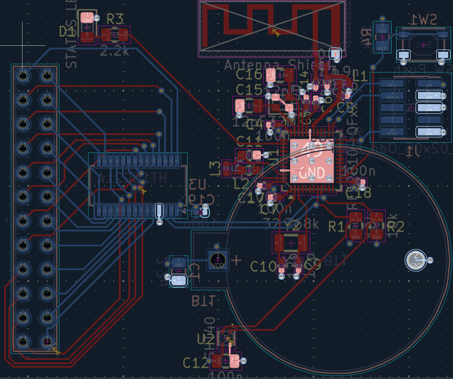
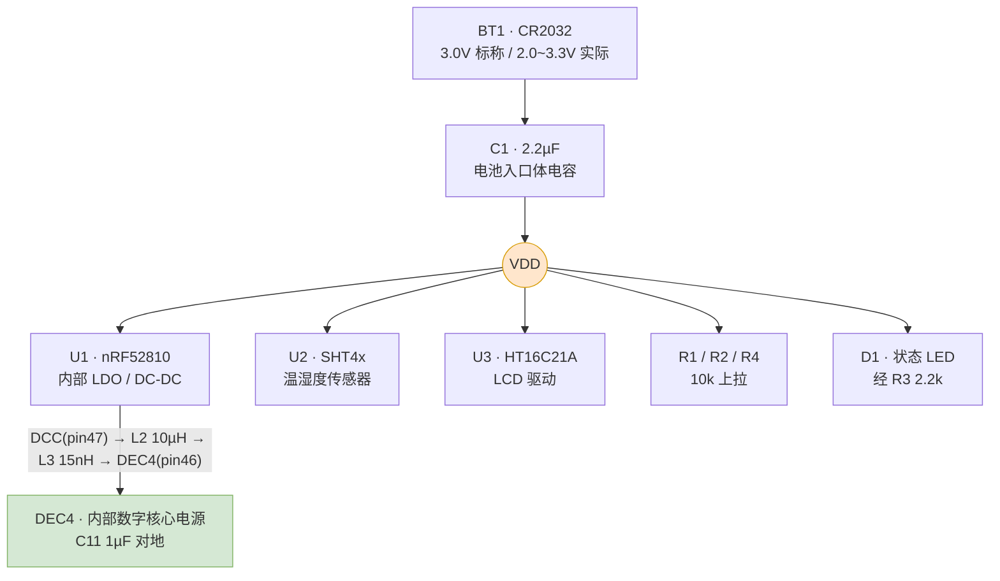
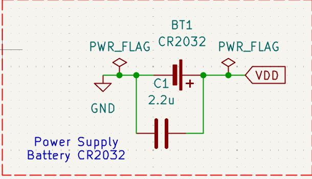
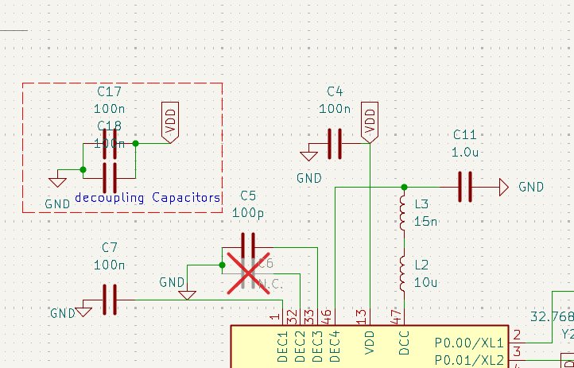
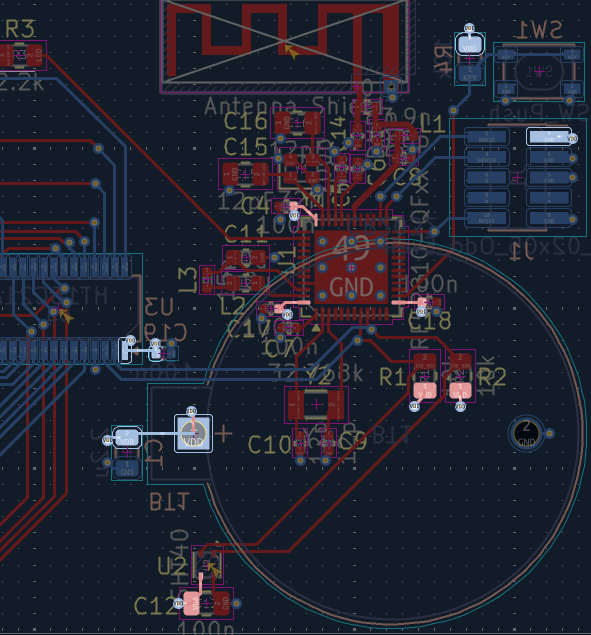
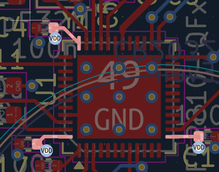

# 电源模块布线分析报告

> 项目：开源智能温湿度传感器 Pro PCB 设计
> 姓名：谢天成
> 周次：第 5 周（2026.09.21—2026.09.27）
> 对应交付物：第 5 周交付物 ② —— 电源模块布线分析报告

---

## 1. 报告目的与范围

本报告针对本板**电源模块的布线设计**做专项分析，回答三个问题：

1. **电源架构是什么？为什么这么选？**
2. **走线宽度、过孔、平面是否满足载流与压降要求？**
3. **去耦网络与开关回路的布局是否合理？**

分析对象为 CR2032 电池输入到各负载芯片的完整供电路径，包括：电池入口体电容 C1、nRF52810 内部 DC-DC 的外围（L2 / L3 / C11）、各芯片的去耦电容（C4 / C12 / C17 / C18 / C19）、In1 地平面与 In2 电源平面、以及全部电源/地过孔。

**全板布局总览**（电源相关器件已标注）：



---

## 2. 电源架构

### 2.1 电源树



**关键点：本板没有外部稳压器。** CR2032 直接给整板供电，nRF52810 用**片内 DC-DC** 产生核心电压。

**电源输入级（原理图）**——CR2032 电池座 BT1 经体电容 C1（2.2 µF）后建立 VDD：



### 2.2 电源架构选型：不采用外部 LDO 的依据

第 1、2 周的方案里曾预留 ME6211 LDO，**最终没有使用**，理由是三条：

**① CR2032 的电压本来就在 nRF52810 的范围内，不需要稳压。**

| 器件 | 数据手册供电范围 | 手册出处 |
|---|---|---|
| **U1 nRF52810** | **1.7 V ~ 3.6 V** | PS v1.1 §8 推荐工作条件 |
| **U2 SHT4x** | **1.08 V ~ 3.6 V**（典型 3.3 V） | Datasheet v7.3 §3 电气规格 |
| **U3 HT16C21A** | **2.4 V ~ 5.5 V** | Datasheet v1.30 直流电气特性 |

CR2032 的开路电压约 3.0~3.3 V，低于 nRF52810 的 3.6 V 上限；放电末端约 2.0 V。三者中 **U3 的 2.4 V 下限是最紧的约束**，所以整机的可用电池区间由 LCD 驱动决定，为 **2.4 V ~ 3.3 V**。

**② 采用 LDO 会引入额外损耗。** LDO 为线性降压，输出必须低于输入，而本板输入仅 3.0 V。若用 LDO 输出 1.8 V 给核心供电，1.2 V 压差将全部转为热量，效率约 60%；片内 DC-DC 为开关变换，效率显著更高，且 Nordic 已提供完整的 DC-DC 参考电路。

**③ 减少一级器件可降低静态损耗与失效点。** LDO 自身静态电流（ME6211 约数十 µA）将直接计入整机静态功耗，该量级与 LCD 常显电流相当。

**架构确定：采用 CR2032 直供 + nRF52810 片内 DC-DC 的架构。**

> **设计代价（需明确记录）**：整机在电池低于 **2.4 V** 时 LCD 驱动会先失效（nRF52810 还能工作到 1.7 V）。若后续要提高电池利用率，需要换用低压 LCD 驱动或增加升压电路。

### 2.3 nRF52810 内部 DC-DC 的外围

片内 DC-DC 需要**两个外部无源器件**（Nordic PS §5.3 明确说明："Two additional external passive components are required to use the DC/DC regulator"）。本板的实现：

```
U1.DCC (pin 47) ──[ L2 · 10 µH ]──[ L3 · 15 nH ]──┬── U1.DEC4 (pin 46)
                                                    │
                                               C11 · 1.0 µF
                                                    │
                                                   GND
```

- **L2（10µH）** 是 DC-DC 的储能电感，Nordic 要求 **IDC,min = 50 mA**（参考设计表注明）。最终选用 Murata `LQM21FN100M80L`（0805，Itemp 100 mA），选型依据见 §10。
- **L3（15nH）** 串在 L2 之后，是 Nordic 参考设计里的**谐波滤波电感**，用来抑制开关谐波。它和 C11 构成第二级 LC。
- **C11（1.0µF）** 是 DC-DC 的输出电容，Nordic 参考设计标注为 X5R、±10%。

**U1 电源引脚与 DC-DC 外围（原理图）**——可见 DEC1(1) / DEC2(32) / DEC3(33) / DEC4(46) / VDD(13) / DCC(47) 六个引脚及其外围 C7、C6(N.C.)、C5、C11、L3、L2、C4、C17、C18：



---

## 3. 电流预算

| 器件 | 工作状态 | 电流 | 出处 |
|---|---|---|---|
| **U1 nRF52810** | System OFF，无 RAM 保持 | **0.3 µA** | PS v1.1 特性表 |
| | System OFF，24 kB RAM 保持 | 0.5 µA | 同上 |
| | System ON，24 kB RAM 保持 + RTC 唤醒 | **1.5 µA** | 同上 |
| | TX 峰值（0 dBm） | **4.6 mA** | 同上 |
| | RX 峰值 | **4.6 mA** | 同上 |
| **U2 SHT4x** | 平均 | **0.4 µA** | Datasheet v7.3 特性表 |
| | 空闲 | 80 nA | 同上 |
| **U3 HT16C21A** | LCD 显示开启（3 V，无负载） | **18 µA**（max 36 µA） | Datasheet v1.30 直流电气特性 |
| | LCD 显示关闭，振荡器开 | 2 µA | 同上 |
| | 待机（振荡器关） | max 1 µA | 同上 |
| **D1 状态 LED** | 点亮（R3 = 2.2 kΩ） | **≈ 0.45 mA** | (3.0 − 2.0) V ÷ 2.2 kΩ 估算 |
| R1 / R2 / R4 | I2C 空闲、按键未按下 | ≈ 0（仅漏电） | — |

**静态电流合计（LCD 常显、LED 熄灭、BLE 空闲）≈ 20 µA。**

按 CR2032 典型容量 **220 mAh** 估算：

```
t = 220 mAh ÷ 20 µA ≈ 11 000 h ≈ 1.25 年
```

实际续航会被 CR2032 的**自放电**（约每年 1~2%）和 BLE 广播占空比拉低。例如每 1 s 广播一次、每次 3 ms @ 4.6 mA，平均再增加 `4.6 mA × 3 ms / 1 s ≈ 13.8 µA`，续航约减半。

> **结论**：本板**没有大电流负载**。峰值最高的 nRF52810 TX 也只有 4.6 mA。这直接决定了下面第 4 节的走线宽度选择。

---

## 4. 走线宽度与载流能力

### 4.1 按 IPC-2221 校核

本板电源/地走线宽度为 **0.20 mm**，铜厚 **35 µm（1 oz）**。按 IPC-2221 外层走线载流公式：

```
I = k · ΔT^0.44 · A^0.725        k = 0.048（外层），ΔT 单位 °C，A 单位 mil²
```

- 线宽 0.20 mm = 7.87 mil，铜厚 35 µm = 1.378 mil
- 截面积 `A = 7.87 × 1.378 = 10.85 mil²`
- 取温升 ΔT = 10 °C：

```
I = 0.048 × 10^0.44 × 10.85^0.725
  = 0.048 × 2.754 × 5.63
  ≈ 0.74 A
```

| | 数值 |
|---|---|
| IPC-2221 允许载流（ΔT = 10 °C） | **≈ 740 mA** |
| 本板实际最大电流（nRF TX 峰值） | **4.6 mA** |
| **利用率** | **≈ 0.6 %** |

**余量约 160 倍，载流能力完全不是约束。**

### 4.2 走线宽度未加宽的原因

0.20 mm 是**本工程的布线规则下限**，选择它的原因不是载流，而是**空间约束**：

- U1 是 **QFN-48、引脚间距 0.4 mm**。焊盘之间能容纳的最大线宽只有约 0.2 mm（第 2 周已确认，因此删除了 PWR netclass 的加宽规则）。
- 板子是 **48.2 × 40 mm**，底层还要走 24 根 LCD 段码线，走线通道紧张。

> **设计取舍**：既然电流只有 4.6 mA（余量 160 倍），**用最小线宽换取布线通道是正确选择**。用宽走线反而会挤掉 LCD 段码线的通道。这一条是本板电源设计与常规"电源线要加粗"直觉相反的地方，已明确记录。

> **注**：本板电源与地走线**全部为 0.20 mm**，与规则下限一致，没有例外。

---

## 5. 布线实现概况

全板电源与地走线**全部为 0.20 mm**，与规则下限一致，无例外。

| 项目 | 数值 |
|---|---|
| VDD 网络走线总长 | 24.3 mm |
| GND 网络走线总长 | 33.8 mm |
| 全板过孔总数 | **66 个**（规格统一：外径 0.7 mm / 钻孔 0.3 mm） |
| 其中 VDD / GND 过孔 | 12 / 37 |

**DC-DC 相关的三条网络全部为 0 过孔、全部位于 F.Cu**，回路为单层闭合结构（见第 6 节）。

---

## 6. DC-DC 开关回路分析

开关电源的 EMI 与噪声主要来自**开关电流流经的环路面积**。环路越大，辐射和感应噪声越强。因此 DC-DC 布局的核心原则是：**把开关回路做到最小，且尽量不换层。**

### 6.1 实际布局

电路拓扑见 §2.3。三者的物理排列为：**L3、L2 在 U1 左侧一字排开，C11 位于其下方**，整个开关回路集中在 U1 西侧的一小块区域内。



### 6.2 分析结论

| 检查项 | 结果 | 评价 |
|---|---|---|
| **换层次数** | **0 次** | ✅ 整个开关回路单层闭合，不引入过孔电感，也不需要用平面做回流 |
| **走线角度** | 全部 45° 折线 | ✅ 无直角，避免阻抗突变与尖端放电 |
| **回路包围面积** | 约 **16 mm²** | ✅ 集中在 U1 西侧一小块区域内 |
| **L2 与 L3 间距** | 紧邻（约 1.5 mm） | ✅ 中间不引出分支 |
| **C11 到 DEC4 引脚** | 约 5 mm，为全回路中最长的一段 | ⚠️ 见下 |

**关于过孔**：从第 3 周叠层分析，F.Cu 到 In1 的地过孔电感为 0.101 nH，而 F.Cu 到 In2 的电源过孔电感为 **1.017 nH**（需穿过 1.065 mm 的芯板）。开关回路若换层，将串入 1 nH 量级的电感，在高 di/dt 下产生电压尖峰。本板三条 DC-DC 网络**全部为 0 过孔、全部在 F.Cu**，回路为单层闭合结构。

**关于 C11 的走线长度**：C11 的 VDD 侧（DEC4）走线约 5 mm，比理想值（<2 mm）长。C11 是 DC-DC 的**输出**电容，作用是平滑已经过 L2/L3 两级滤波的电压，对布局的敏感度低于输入侧去耦电容。当前路径是为避开 U1 西侧的射频区与晶振走线而形成的，属于布局取舍的结果。

---

## 7. 去耦电容布局分析

### 7.1 去耦电容清单与归属

| 电容 | 容值 | 封装 | 去耦对象 |
|---|---|---|---|
| **C1** | 2.2 µF | 0805 | **电池入口体电容**（全局储能） |
| **C4** | 100 nF | 0402 | U1 · VDD (pin 36) |
| **C17** | 100 nF | 0402 | U1 · VDD (pin 48) |
| **C18** | 100 nF | 0402 | U1 · VDD (pin 13) |
| **C12** | 100 nF | 0805 | U2 · SHT4x |
| **C19** | 100 nF | 0402 | U3 · HT16C21A |
| C7 | 100 nF | 0402 | U1 · DEC1 |
| C6 | **N.C.** | 0402 | U1 · DEC2（不贴） |
| C5 | 100 pF | 0402 | U1 · DEC3 |
| **C11** | 1.0 µF | 0603 | U1 · DEC4（DC-DC 输出） |

**布局原则：每个 IC 至少一颗就近去耦。** nRF52810 有 3 个 VDD 引脚，配了 3 颗 100 nF（C4 / C17 / C18），做到"一引脚一电容"。

### 7.2 就近程度

三颗服务于 U1 的 100 nF 电容，各自到所对应 VDD 引脚的走线距离：

| 电容 | 对应引脚 | 走线距离 |
|---|---|---|
| C4 | U1.VDD-36 | 1.64 mm |
| C17 | U1.VDD-48 | 1.62 mm |
| C18 | U1.VDD-13 | 1.45 mm |

> 三颗均在 **1.6 mm 以内**，且各自的接地过孔均落在焊盘旁 1 mm 以内。
>
> C1（2.2 µF 体电容）与 C19（U3 去耦）距 U1 较远属正常——二者分别服务于电池入口与 LCD 驱动，不与 U1 比距离。

### 7.3 去耦回路电感与自谐振

去耦效果取决于**从电容到芯片引脚这一整圈的电感**。按第 3 周叠层分析得到的单位电感值：

| 组成部分 | 单位值 | 本板实际 | 电感贡献 |
|---|---|---|---|
| 顶层走线 | 0.30 nH/mm | 约 1.6 mm | **0.48 nH** |
| 电源过孔 F.Cu → In2.Cu | 1.017 nH/个 | 1 个 | **1.017 nH** |
| 地过孔 F.Cu → In1.Cu | 0.101 nH/个 | 1 个 | **0.101 nH** |
| 平面扩展 | 对数增长，近距离可忽略 | — | ≈ 0 |
| **回路寄生合计** | | | **≈ 1.60 nH** |
| 0402 100 nF 自身 ESL | — | — | ≈ 0.6 nH |
| **总电感** | | | **≈ 2.2 nH** |

**自谐振频率**：

```
f_SRF = 1 / (2π√(L·C)) = 1 / (2π√(2.2 nH × 100 nF)) ≈ 10.7 MHz
```

**含义**：
- 在 **10.7 MHz 以下**，这颗电容表现为容性，阻抗随频率下降，去耦有效；
- 超过 10.7 MHz 后转为感性，阻抗反而上升——此时靠 **In1/In2 平面之间的平板电容**和 PCB 自身电容继续提供低阻抗。

**这个 10.7 MHz 的边界说明了一件事**：分立电容**管不到 2.4 GHz 的射频**。射频段的电源纯净度靠的是**完整的 In1 地平面 + In2 电源平面**（平面间介质仅 1.065 mm）以及 U1 的 EP 散热焊盘 + 9 个散热过孔，而不是这几颗 100 nF。

**U1 周边的三颗去耦电容与散热过孔**——图中可见 U1 的散热焊盘（pad 49，标 "GND"）及其下方的 **3×3 散热过孔阵列**；左上为 C17（100 n）、上方为 C4（100 n）、右侧为 C18（100 n），三颗均紧贴各自的 VDD 引脚：



---

## 8. 平面与过孔

### 8.1 电源/地平面

| 层 | 网络 | 作用 |
|---|---|---|
| **In1.Cu** | **GND** | 完整地平面，距 F.Cu 仅 **0.2104 mm** 介质 |
| **In2.Cu** | **VDD** | 完整电源平面 |

**叠层（嘉立创 4 层，总厚约 1.6 mm）**：

```
F.Cu      0.035 mm   信号 / 电源走线
prepreg   0.2104 mm  εr 4.4
In1.Cu    0.0152 mm  ← GND 平面
core      1.065 mm   εr 4.5
In2.Cu    0.0152 mm  ← VDD 平面
prepreg   0.2104 mm  εr 4.4
B.Cu      0.035 mm   信号
```

**该叠层对电源设计的影响**：地平面 In1 位于顶层下方 0.21 mm，去耦电容的地过孔电感仅 0.101 nH（见 §7.3）。而电源过孔要到 In2，需要穿过 1.065 mm 芯板，电感 1.017 nH——**两者相差 10 倍**。

> **由此定出的布局优先级**：先保证**电容地焊盘就近打孔下 In1**，再考虑电源过孔。实测结果：GND 过孔距离 0.60~0.82 mm，VDD 过孔距离 0.59~0.65 mm，两者都做到了 1 mm 以内。

### 8.2 过孔统计

| 网络 | 过孔数 | 规格 |
|---|---|---|
| **GND** | **37** | 0.7 / 0.3 mm |
| **VDD** | **12** | 0.7 / 0.3 mm |
| 其他信号 | 17 | 0.7 / 0.3 mm |
| **合计** | **66** | 全板统一 |

**U1 散热焊盘（EP）过孔**：EP 为 4.6 × 4.6 mm，下方布置 **3 × 3 = 9 个过孔**阵列，全部落在焊盘内（`via-in-pad`），孔径 0.3 mm。作用是把 QFN 的热量导入 In1 地平面。

> **待与板厂确认**：盘中孔（过孔位于焊盘内）是否需采用**树脂塞孔 + 电镀填平（IPC-4761 Type VII）**工艺，及其对报价与交期的影响。若不塞孔，回流焊时焊料将沿孔壁虹吸流失，导致 EP 焊接虚空。

**U1 散热焊盘过孔阵列与周边去耦电容的实际效果**（见 §7.3 图）：散热焊盘中央的 3×3 阵列清晰可见，三颗 100 nF 去耦电容（C4 / C17 / C18）分布在 U1 三个方向上。

---

## 9. IR 压降与噪声估算

### 9.1 走线电阻

外层铜（1 oz）在 0.20 mm 线宽下的单位长度电阻：

```
R = ρ·L/A = 1.72×10⁻⁸ Ω·m ÷ (0.20 mm × 0.035 mm)
  = 1.72×10⁻⁸ ÷ 7.0×10⁻⁹  ≈ 2.46 mΩ/mm
```

### 9.2 最坏情况 IR 压降

**场景一：nRF52810 TX 脉冲**（最主要的高电流事件）

TX 脉冲由**就近的去耦电容**供电（C17 距引脚 1.62 mm，走线 + 过孔）：

```
R ≈ 1.62 mm × 2.46 mΩ/mm + 过孔电阻 ≈ 4.0 mΩ + 0.2 mΩ ≈ 4.2 mΩ
ΔV = 4.6 mA × 4.2 mΩ ≈ 0.019 mV
```

**场景二：从电池端到最远负载（U3 LCD 驱动）**

```
路径长度 ≈ 10 mm
R ≈ 10 mm × 2.46 mΩ/mm ≈ 24.6 mΩ
ΔV = 36 µA（U3 最大工作电流）× 24.6 mΩ ≈ 0.0009 mV
```

| 场景 | 电流 | 路径电阻 | **IR 压降** | 占 3.0 V 的比例 |
|---|---|---|---|---|
| nRF TX 脉冲 | 4.6 mA | 4.2 mΩ | **0.019 mV** | 0.0006 % |
| U3 工作 | 36 µA | 24.6 mΩ | **0.0009 mV** | 0.00003 % |

**PCB 上的 IR 压降可忽略。**

### 9.3 供电压降的主要来源

> **说明**：本板供电的最大压降来源是 **CR2032 的内阻**，不是 PCB。
>
> CR2032 的内阻典型值为 **10~40 Ω**（远大于 PCB 的毫欧级）。以 20 Ω 估算，nRF52810 TX 时从电池抽取约 2.3 mA（DC-DC 输入侧），压降为：
>
> ```
> ΔV = 2.3 mA × 20 Ω ≈ 46 mV
> ```
>
> 占 3.0 V 的 **1.5%**。这个量级仍然安全（nRF 的欠压阈值约 1.7 V），但它比 PCB 的贡献**大了三个数量级**。
>
> **这进一步印证了第 4 节的结论**：本板电源走线宽度的选择依据是**布线通道**，不是压降——因为压降根本不发生在 PCB 上。

**体电容 C1（2.2 µF）的作用**在这里体现：BLE 发送瞬间的电流尖峰由 C1 就近提供，避免全部由高内阻的电池承担。以 100 µs 的脉冲估算：

```
ΔV = I·t/C = 2.3 mA × 100 µs ÷ 2.2 µF ≈ 0.105 mV
```

---

## 10. 与 Nordic 参考设计的对比

本板的电源外围与 Nordic 官方参考设计（PS v1.1 §7.3.2，QFAA QFN48 + DC/DC 方案）**逐项对上了**：

| 功能 | Nordic 参考值 | 本板 | 是否一致 |
|---|---|---|---|
| 射频匹配电感 | L1 = 3.9 nH | L1 = 3.9 nH | ✅ |
| 射频匹配电容 | C4/C5/C8 = 0.8 pF | C8 = 0.8 pF | ✅ |
| 32 MHz 晶振负载 | C1/C2/C11/C12 = 12 pF (NP0 ±2%) | C15/C16 = 12 pF | ✅ |
| DC-DC 储能电感 | L2 = 10 µH（IDC,min = 50 mA） | L2 = 10 µH | ⚠️ 见下 |
| DC-DC 谐波电感 | L3 = 15 nH | L3 = 15 nH | ✅ |
| DC-DC 输出电容 | C10 = 1.0 µF (X5R) | C11 = 1.0 µF | ✅ |
| DEC3 电容 | C7 = 100 pF | C5 = 100 pF | ✅ |
| VDD 去耦 | C1/C2/C11/C12 = 100 nF ×4 | C4/C12/C17/C18/C19 = 100 nF ×5 | ✅ 多于参考 |
| DEC2 电容 | C6 = N.C. | C6 = N.C.（DNP） | ✅ |
| 主储能电容 | C9 = 4.7 µF | C1 = 2.2 µF | ⚠️ 见下 |

**两处偏差，均已评估：**

**① 体电容从 4.7 µF 降到 2.2 µF**

出于成本与封装考虑（0805 2.2 µF 单价 0.24 元）。按 9.3 节估算，2.2 µF 对 100 µs 级脉冲的电压跌落仅 0.105 mV，**余量充足**。若后续实测发现 BLE 发送时电源纹波偏大，这是第一个可以加大的器件。

**② L2 的额定电流：原选型不满足要求**

Nordic 明确要求 DC-DC 储能电感 **IDC,min ≥ 50 mA**。本板选用 **Sunlord SDFL1608S100KTF（0603，10 µH）**。查 Sunlord《SDFL Series》规格书（2021/05/15 版）第 3 页，该型号（规格书中写作 `SDFL1608S100□TF`）的完整参数为：

| 参数 | 符号 | 本板器件实测规格 |
|---|---|---|
| 电感量 | L | 10 µH |
| 最小品质因数 | Q | 30 |
| L/Q 测试频率 | Freq. | 2 MHz |
| 自谐振频率 | — | 17 MHz |
| 最大直流电阻 | DCR | **1.85 Ω** |
| **最大额定电流** | **Ir** | **3 mA** |

对照 Nordic 的要求：

```
Nordic 要求  IDC,min ≥ 50 mA
本板实际     Ir      =  3 mA
                       ↑ 相差 17 倍
```

**根因：选错了元件类别。**

SDFL 系列在规格书首页的标题是 **"Multilayer Chip Ferrite Inductor"（多层片式铁氧体电感）**，其"应用"一栏写的是 *"Communications, Video and audio equipment, Computer, Remote control"* —— 这是**信号/噪声滤波用途**的器件，不是功率变换用的储能电感。同类器件的对照：SDFL1608 整个系列（0.68 µH ~ 33 µH）的额定电流范围只有 **1 ~ 35 mA**，全部是毫安级。

Sunlord 的功率电感是另外的产品线（SWPA / SWRH / MWSA 等绕线或模压系列）。

**实际工作电流估算：**

```
nRF52810 TX（0 dBm，DC-DC 模式）VDD 电流 ≈ 4.6 mA
DC-DC 输入功率 = 3.0 V × 4.6 mA = 13.8 mW
设效率 85% → 输出功率 11.7 mW
核心电压约 1.3 V → 电感平均电流 ≈ 11.7 mW ÷ 1.3 V ≈ 9 mA
```

**L2 需要承载约 9 mA 的平均电流（还要叠加开关纹波的峰值），而器件额定只有 3 mA —— 超额定 3 倍。**

**后果**：多层铁氧体电感的直流偏置特性很差，在超过额定电流后电感量会显著下降。电感量一旦跌落，DC-DC 的纹波电流将急剧增大，可能导致：

- 输出纹波超标，效率下降
- 开关峰值电流触及限流点，DC-DC 进入异常工作状态
- 传导/辐射 EMI 恶化（开关电流 di/dt 增大）

该问题已在打样前完成修正，替换型号的核定过程见 §11.1。

**替换选型结论（2026-09-27 完成核对）：**

选用 **Murata `LQM21FN100M80L`**（0805/2012，立创编号 C162582）。该器件在 Murata 官方目录《Chip Inductors》O05E.pdf 中的完整参数：

| 参数 | 数值 |
|---|---|
| 电感量 | 10 µH ±20%（测试频率 1 MHz） |
| **额定电流 Itemp**（温升基准） | **100 mA** |
| **直流电阻 DCR** | **0.30 Ω ±30%** |
| **自谐振频率 S.R.F.（min.）** | **15 MHz** |
| 工作温度范围（不含自温升） | −55 ~ +125 °C |
| 磁屏蔽 | **Class of Magnetic Shield: Ferrite Core** |
| 系列定位 | **"Inductors for Power Lines"**（功率线用电感） |

**关键差异**：本系列在 Murata 目录中被归入 **"Inductors for Power Lines"**，功能性定位正确——这正是原选型（SDFL，信号级）所缺的。

**饱和特性核对**：Murata 该系列**只规定 Itemp，未给出数值化的 Isat**，需从目录中的 **Inductance-Current Characteristics（DC-Bias，20 °C）** 曲线读取：

| 直流偏置电流 | 剩余电感量 | 占标称值 |
|---|---|---|
| **9 mA（本板实际工作点）** | ≈ 10 µH | **≈ 100 %** |
| **50 mA（Nordic 要求下限）** | ≈ 10 µH | **≈ 100 %** |
| 60 mA | ≈ 10 µH | ≈ 100 % |
| 90 mA | ≈ 9 µH | ≈ 90 % |
| 120 mA | ≈ 7.5 µH | ≈ 75 % |
| 180 mA | ≈ 5 µH | ≈ 50 % |

**结论：本板的实际电感平均电流约 9 mA，处于曲线的完全平坦区，不存在饱和风险；即使按 Nordic 的 50 mA 下限考核，也仍在平坦区内。**

> **说明**：① Murata 该系列目录未提供数值化的 Isat 标称值，上表数据系从 DC-Bias 特性曲线读取；② 该曲线标定温度为 20 °C，高温下饱和点会前移，本板工作电流相对曲线拐点有 5 倍以上余量，降额影响可忽略。

**DCR 收益**：由 1.85 Ω 降至 0.30 Ω，9 mA 下的压降从 16.6 mV 降到 2.7 mV。

---

## 11. 遗留问题与后续建议

| # | 问题 | 影响 | 处理 |
|---|---|---|---|
| **1** | **L2 原选型（`SDFL1608S100KTF`，10 µH）额定电流仅 3 mA，不满足 Nordic 要求的 IDC,min ≥ 50 mA** | 多层铁氧体电感在 3 倍额定电流下会饱和，电感量跌落，DC-DC 纹波与 EMI 恶化，可能触及限流 | ✅ **已修正**：更换为 Murata `LQM21FN100M80L`（立创 C162582，Itemp 100 mA / DCR 0.30 Ω），封装与布局改动已完成，见 §11.1 |
| **2** | **U1 散热焊盘的 9 个盘中孔未确认塞孔工艺** | 不塞孔会导致回流焊时焊料虹吸，EP 焊接虚空 | **下单前向嘉立创确认**是否需树脂塞孔 + 电镀填平及加价 |
| **3** | **电池低于 2.4 V 时 U3（LCD 驱动）先失效** | 整机可用区间被限制在 2.4~3.3 V，CR2032 有一部分容量用不上 | 已作为架构代价记录；若要改善需换低压 LCD 驱动或加升压 |
| **4** | **C1 体电容由参考设计的 4.7 µF 降为 2.2 µF** | 理论余量充足，但未经实测验证 | 样机阶段实测 BLE 发送时的 VDD 纹波；超标则加大 C1 |
| **5** | **本板无外部 LDO，VDD 直接跟随电池电压** | 传感器与 LCD 的读数会随电池电压轻微变化 | 湿度测量不受影响（SHT4x 内部有稳压）；LCD 对比度会随电压变化，必要时软件补偿 |

### 11.1 L2 的替换与实施结果

**替换前后对比：**

| 项目 | 原选型 | **最终选型** |
|---|---|---|
| 型号 | Sunlord `SDFL1608S100KTF` | **Murata `LQM21FN100M80L`** |
| 立创编号 | C1035 | **C162582** |
| 封装 | 0603 / 1608 | **0805 / 2012** |
| 系列定位 | Multilayer Chip Ferrite | **Inductors for Power Lines** |
| 额定电流 Itemp | 3 mA | **100 mA** |
| DCR | 1.85 Ω | **0.30 Ω** |
| 自谐振频率 | 17 MHz | 15 MHz min |
| 磁屏蔽 | — | Ferrite Core |

**已完成的板级改动：**

1. L2 封装由 `Inductor_SMD:L_0603_1608Metric` 更换为 `Inductor_SMD:L_0805_2012Metric`
2. 为容纳 0805 的尺寸，L2 向西微移，L3 与 C11 同步调整位置
3. 重新连接 `L2 → U1.DCC` 与 `L2 → L3` 两段走线

**换型后的验证结果：**

| 检查项 | 结果 |
|---|---|
| 封装适配性 | KiCad `L_0805_2012Metric` 的 land pattern 与 Murata 手册推荐的 `LQM21D/21F/21P` 标准值吻合 |
| 周边器件间距 | C11、C17 的 courtyard 与 L2 均无重叠 |
| 全板 courtyard 重叠 | **0 处** |
| DC-DC 三条网络过孔 | **0**（仍为单层闭合） |
| **DRC 复跑** | **4 条 warning，与换型前完全一致；0 条 error** |

---

## 附录：数据来源

| 数据 | 来源 |
|---|---|
| nRF52810 供电范围、电流、ESD、参考电路 | Nordic nRF52810 Product Specification v1.1 §5.2 / §5.3 / §7.3 / §8 |
| SHT4x 供电范围与电流 | Sensirion SHT4x Datasheet v7.3 §3 电气规格、特性表 |
| HT16C21A 供电范围与电流 | HOLTEK HT16C21A Datasheet v1.30 直流电气特性 |
| L2 原选型额定电流、DCR、自谐振频率 | Sunlord《Multilayer Chip Ferrite Inductor – SDFL Series》规格书（2021/05/15 版）第 3 页，型号 SDFL1608S100□TF |
| L2 新选型全部参数与 DC-Bias 曲线 | Murata《Chip Inductors》目录 O05E.pdf（2017/04/28）第 149 页，LQM21FN_80 Series 规格表及 Inductance-Current Characteristics 曲线 |
| 叠层参数与过孔/走线单位电感 | 本项目《叠层方案.md》第 3 周 |
| 走线长度、线宽、过孔坐标 | PCB 文件实测统计（KiCad 10） |
| 载流公式 | IPC-2221 印制板设计通用标准 |

---

*报告完*
