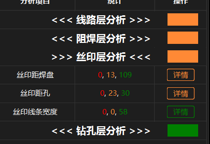
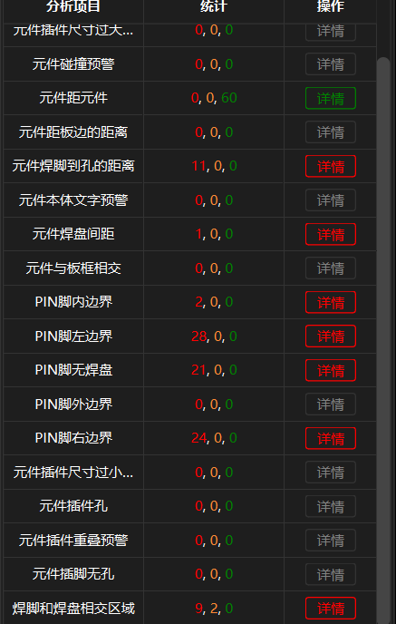
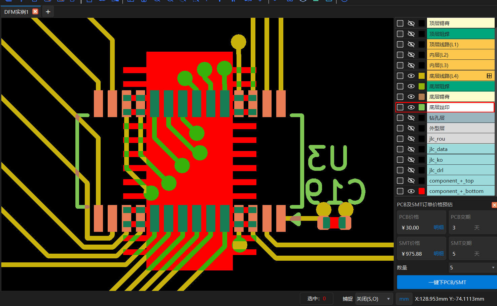
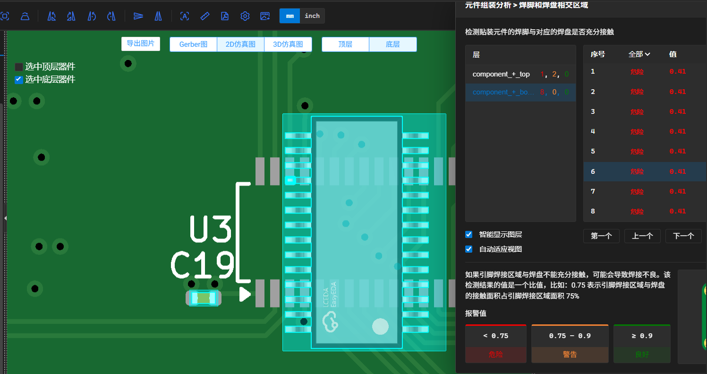
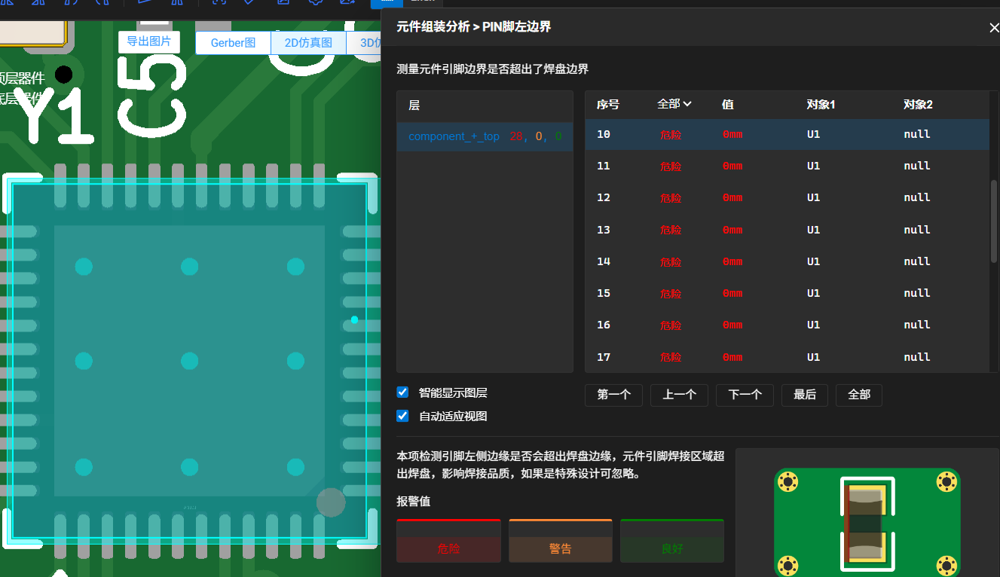
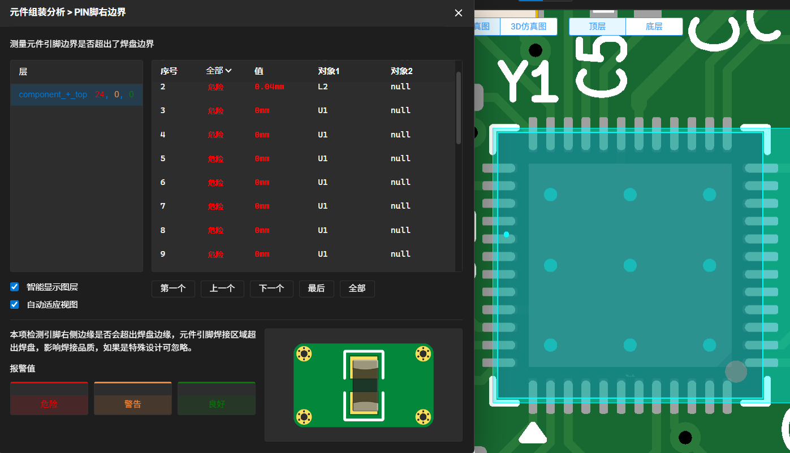
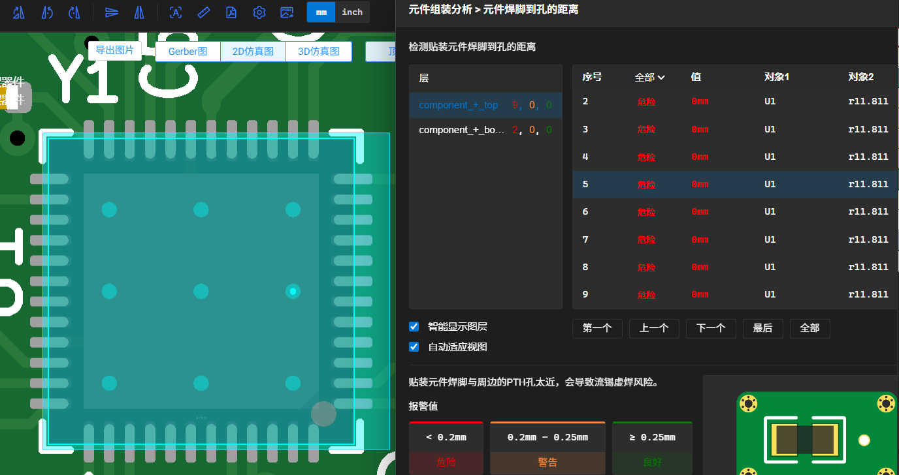

# DFM 检查报告与优化记录

**项目**：智能温湿度传感器（方案 B）· 四层板 · nRF52810 + SHT40 + HT16C21A + 20×4 段码 LCD + CR2032
**检查工具**：嘉立创 DFM（Gerber + 钻孔 + CPL + BOM 全量提交）
**提交批次**：`正式工程_方案B/生产文件_20261009/`
**本报告日期**：2026-10-11 初稿 / **2026-10-12 定稿**（补入评审确认结论，见 §5；并按当日下单页截图复核工艺选项的落实状态）
**配套文档**：《DFM 可制造性设计说明》（设计要求与工艺能力核对）、**《U3 贴装方向说明（提交嘉立创 SMT 审核用）》**

> 本报告只记录三件事：**报了什么、为什么、依据在哪**。设计本身的取舍与工艺能力核对见《DFM 可制造性设计说明》。
> 全部结论都可以用本文引用的截图独立复核。

---

## 1. 结论摘要

| 分析层 | 危险 | 警告 | 处理 |
|---|---|---|---|
| 线路层 | **0** | 少量（同网络） | 无需处理 |
| 阻焊层 | **0** | 1 | 高于板厂下限，不处理 |
| 丝印层 | **0** | 36 | 已整改（109 条危险清零）；余 36 条落在 DFM 的预警档 |
| 钻孔层 | **0** | 0 | — |
| **元件组装（SMT）** | **96** | **2** | 已完成分类与原因分析；**三项处理方式已由评审确认**（2026-10-12，见 §5.1）—— 不改版、不修改 CPL |

**一句话结论**：PCB 侧无危险项。元件组装侧的 96 条危险**已完成分类与原因分析**，来源与状态如下：

| 来源 | 条数 | 状态 |
|---|---|---|
| U3 库模型朝向与板上焊盘相差 90° | **30**（20 + 8 + 2） | **交嘉立创贴装审核确认；不改版、不修改 CPL**，提交书面说明（§3.2、§5.1） |
| U1 散热盘盘中孔（设计意图） | **10**（9 + 1） | **首版采用盘中孔工艺，不做简化**（§3.4、§5.1） |
| U1 引脚边界轮廓差异 | **48**（左 26 + 右 22） | **保留现有焊盘，不改版**（§3.3、§5.1） |
| L2 引脚边界轮廓差异 | **6**（左 2 + 右 2 + 内 2） | **保留现有焊盘，不改版**（§3.5、§5.1） |
| U2 中心盘（设计意图，板上本无此盘） | **1** | 原因已明确（§3.6） |
| 同网络铜重叠 | **1** | 允许，无需处理（§3.7） |
| **合计** | **96** | |

**板上焊盘的数量、尺寸、间距已逐个数 Gerber 闪光核对**：U1 48 个侧焊盘（0.20 × 0.80 mm）+ 4.6 × 4.6 散热盘、U3 28 个（0.40 × 1.20 mm）、U2 4 个、L2 2 个 —— 数量、尺寸与间距均与设计一致，**边界类警报不由"缺铜"引起**。

---

## 2. PCB 层分析（线路 / 阻焊 / 丝印 / 钻孔）

四层的汇总截图见上一节 **[截图 3]**。

| 分析层 | 危险 | 警告 | 最紧的实测值 |
|---|---|---|---|
| 线路层 | 0 | 同网络若干 | 走线间距 **0.200 mm**、盘到线 **0.200 mm**、盘到铜皮 0.200 mm、孔环 0.200 mm、线宽 0.200 mm；VIA 孔到焊盘 **0.150 mm**（2 处）、焊盘距焊盘 **0.107 mm**（1 处）——后两项经核对均为**同网络** |
| 阻焊层 | 0 | 1 | 阻焊桥 **0.200 mm**；最小的开窗到走线 0.125 mm（1 处，高于嘉立创 0.09 mm 下限） |
| 丝印层 | 0 | 36 | 丝印距焊盘 最小 **0.137 mm**（13 条落在 DFM"警告"带）；丝印距孔 最小 **0.131 mm**（23 条）；丝印线宽 **0.160 mm**，58 条全部达标 |
| 钻孔层 | 0 | 0 | 无告警 |

异网络的铜净距全板最小为 **0.200 mm**，与设计规则（网络类间距 0.20 mm）一致，无更紧处。

> 数字来源：**丝印层**一行的条数取自 DFM 界面截图 `【截图 3】`；线路层、阻焊层、钻孔层的条数与全部实测值取自 DFM 的导出数据 `dfm.json`（导出条目数略少于界面显示，见 §6）。

### 2.1 丝印整改（本批唯一改动过 PCB 图形的一项）

上一版（10-09 01:39）的 DFM 报出丝印 **109 条危险**：丝印距孔 46 条、丝印距焊盘 63 条；另有丝印线宽 69 条警告（线宽 0.12 mm，低于 0.15 mm 下限）。

**整改**：元件外框线宽 0.12 mm → **0.16 mm**，并重排位号避让焊盘与过孔。

| 检查项 | 整改前 | 整改后 |
|---|---|---|
| 丝印距孔 | 危险 **46** | 危险 **0** / 警告 23 |
| 丝印距焊盘 | 危险 **63** | 危险 **0** / 警告 13 |
| 丝印线条宽度 | 危险 0 / 警告 69 | **全部达标**（实测 0.1599 ~ 0.1600 mm） |

加粗丝印后，线与焊盘/孔的净距随之变小，因此"警告"档的条目数反而增加（36 条，最紧 0.131 mm）—— 但**危险档已全部清零**。丝印属工艺标识，不影响电气性能。

### 2.2 由本次核对发现的两处文档数据错误

| 文档 | 原文 | 本次核对 | 处理 |
|---|---|---|---|
| `制板说明.txt` §六 | 元件外框线宽 **0.12 mm**，低于下限 0.15 mm | 已改为 0.16 mm，结论反转 | **该节已重写**（见新版 `制板说明.txt`） |
| `制板说明.txt` §二 | 最小焊盘—过孔 **0.125 mm**（3 处：C16.1 / C15.1 / R4.2） | DFM"VIA 孔到焊盘"实测最小 **0.150 mm**（2 处） | 已按 DFM 实测值更正；两值均属同网络，不影响电气判定 |

---

## 3. 元件组装分析（SMT 一节）

### 3.1 总览

| 检查项 | 危险 | 警告 | 良好 | 位号 | 结论 |
|---|---|---|---|---|---|
| 元件距元件 | 0 | 0 | 60 | — | 最小 0.66 mm，远高于 0.20 mm 下限，本来即达标 |
| **PIN脚左边界** | **28** | 0 | 0 | U1 26 / L2 2 | 见 §3.3、§3.5 |
| **PIN脚右边界** | **24** | 0 | 0 | U1 22 / L2 2 | 见 §3.3、§3.5 |
| **PIN脚无焊盘** | **21** | 0 | 0 | **U3 20** / U2 1 | 见 §3.2、§3.6 |
| **焊脚和焊盘相交区域** | **9** | 2 | 0 | **U3 8** / U1 1 / L2 2 | 见 §3.2、§3.3、§3.5 |
| **元件焊脚到孔的距离** | **11** | 0 | 0 | U1 9 / U3 2 | 见 §3.4、§3.2 |
| **PIN脚内边界** | **2** | 0 | 0 | L2 | 见 §3.5 |
| **元件焊盘间距** | **1** | 0 | 0 | — | 见 §3.7 |

**分布在两个模型层上**：`component_+_top` 118 条、`component_+_bottom` 34 条 —— 与"本板有 28 正面 + 9 背面元件"的双面贴装布局一致。

---

### 3.2 U3：立创库模型相对板上焊盘整体差了 90°（20 + 8 条）

**结论先行：这一节报出的红项不是"封装未被识别"。** DFM 不读 `.kicad_pcb`，也不识别封装名；其依据是 BOM 中的立创编号 **C5444716**，从立创元件库调取 SSOP-28 模型，再按 CPL 的 **(131.5425, −70.000) / 90° / Bottom** 叠加到 Gerber 上与板上焊盘比对。**封装尺寸与脚间距均能对上，仅整体朝向相差 90°。**

两组位置都换算到同一坐标系后：

| | 排列方向 | 间距 | 单脚间距 | 跨度 |
|---|---|---|---|---|
| **板上实际焊盘**（Gerber 实测） | 两排，**沿 X** | Y = −67.400 / −72.600，**5.20 mm** | 0.635 mm | 8.255 mm |
| **DFM 模型摆出的引脚** | 两列，**沿 Y** | X = **128.958 / 134.127**，**5.169 mm** | 0.635 mm | 8.255 mm |

两者的**间距、单脚间距、跨度三项完全一致，仅方向互相垂直** —— 即为"相差 90°"，且只有 90° 能同时满足这三个数。**该判断可直接由坐标量测验证**：在 DFM 预览中将光标停在模型最外侧的引脚中心，右下角坐标框读数为 **X ≈ 128.95 或 134.13、Y ≈ −74.11 或 −65.89**（见 `【截图 2】` 右下角读数）；而板上焊盘的中心为 **X = 127.415 … 135.670、Y = −67.400 / −72.600**，两组坐标不重合。

**定量证据（两条互相独立）：**

1. **接触面积比 0.41** —— 落在焊盘上的那 8 个脚，每个只有 **41% 的焊接面积**压在焊盘上（`【截图 4】` 右侧"值"列，报警阈值 < 0.75 为危险）。若是任意角度歪斜，各脚的接触比会有大有小；这里 8 条全是 0.41，说明是**整齐的 90° 旋转**。
2. **20 + 8 = 28** —— 模型共 28 个脚，DFM 报"无焊盘"20 条、"相交区域"8 条，**正好穷尽**。按上面的位置求交集：模型两列分别在 X = 128.958 / 134.127，而板上焊盘每排宽 1.20 mm、两排分别在 Y = −67.4 / −72.6 —— 每个焊盘高度带内正好落得下 2 个模型脚，2 × 2 排 × 2 列 = **8**，其余 28 − 8 = **20**。与报告完全一致。

**为什么只有 U3 暴露**：同为底面、同为 90° 家族的 **U4**（SOT-23-6，CPL 写 −90°）**没有这类告警**。U4 的焊盘是"横两排、每排 3 颗"（Y = −60.9625 / −63.2375），如果 DFM 不应用旋转，6 颗脚会整个错开、必然报红 —— 它没报，说明 **DFM 对别的元件是会正确应用 CPL 旋转角的**。U1、U2、L2 也同样没有这类告警。所以问题出在 **C5444716 这一个料号在立创库里的模型默认朝向**。

**板上设计本身是自洽的**，两点已从 Gerber 原件核实：

- CPL 里 U3 写 **90°**、板文件里 U3 也是 **90°**，两者一致；
- 板上 **U3 的 pad 1 = (135.670, −72.600)**（0.40 × 1.20 mm），其**右侧就是丝印的 1 脚标记**：`B_Silkscreen.gbo` 里一个指向该焊盘的小实心三角，顶点 **(136.1425, −72.6375)**，距该焊盘中心 **0.47 mm**、距焊盘 +X 侧外沿 **0.27 mm**。焊盘编号、焊盘位置、丝印标记三者自洽。

**处理状态：已确认（2026-10-12）。** 评审结论：**交嘉立创在贴装审核环节确认，不改版、也不修改 CPL，只提交一份书面说明。**

CPL 里的 90° 反映的就是板上实际朝向，因此本工程侧无需任何改动；该器件贴装时是否会被正确旋转，由贴装侧在审核时确认。提交用书面说明见**《U3 贴装方向说明（提交嘉立创 SMT 审核用）》**，可直接使用的对外问法见 §5.2 第 1 项。

---

### 3.3 U1：48 条边界告警 = 零余量，不是尺寸不符

DFM 每条边界告警记录的"线段长度"就是它测到的边沿偏差。U1 的 48 条（左 26 + 右 22）**全部落在 0.0000 ~ 0.0002 mm**（截图中"值"列直接显示 `0mm`）—— 即模型引脚外沿与板上焊盘外沿**重合**，属"零余量"提示，不是"差了几十微米"。板上 48 个侧焊盘实测 **0.20 × 0.80 mm**、中心距 ±2.95 mm，与 Nordic 参考设计一致。

U1 另有 1 条"焊脚和焊盘相交区域"，接触面积比落在危险档 —— 那是散热盘（pad 49）被重复计入，与 §3.4 同一处。

> **处理状态：已确认（2026-10-12）。** 评审结论：**首版保留现有焊盘，不改版。**
>
> 依据：DFM 自测偏差为 **0.0000 ~ 0.0002 mm**，即模型引脚外沿与板上焊盘外沿重合，属"零余量"提示而非尺寸不符。放行依据若成文，建议表述为"DFM 自测偏差 ≈ 0"；不宜表述为"焊盘符合 Nordic 推荐"，因为 DFM 标注的锚点坐标与板上焊盘外沿仍相差 0.05 ~ 0.15 mm，其引脚轮廓与板上焊盘并非同一套几何。
>
> 本文不再就此扩展分析。

---

### 3.4 U1：9 条"元件焊脚到孔" = 散热盘盘中孔（设计意图）

DFM 报的 9 条全部是 **U1**，值 **0 mm**，位置 **X ∈ {148.0, 149.8, 151.6} × Y ∈ {−69.2, −67.4, −65.8}** —— 正是 U1 散热盘内 3 × 3 排列的 9 个 0.30 mm 过孔（`【截图 7】` 中"对象1 = U1"、"值 0mm"）。DFM 的报警阈值是 < 0.2 mm 为危险，孔落在焊盘内自然为 0。

**这 9 条属设计意图，不由缺铜引起。** 9 个孔是散热盘通往 In1.GND 平面的必经路径。

**处理方式（已确认）**：指定**盘中孔工艺（树脂塞孔 + 电镀填平，POFV）**。该工艺在下单页对应"阻焊覆盖 = 过孔塞树脂 + 过孔电镀盖帽"，不涉及改板。

> **处理状态：已确认（2026-10-12）。** 评审结论：**首版采用盘中孔工艺，不做简化。** 4 层板的该工艺为收费项，金额由下单页计价器核算。详见《DFM 可制造性设计说明》§3 与《PCB 打样下单说明》§3.3。

---

### 3.5 L2：6 条边界告警 = 25 ~ 38 µm 的引脚悬出

L2（0805 电感）的 6 条（左 2 + 右 2 + 内 2）实测 **0.025 ~ 0.038 mm**，且线段端点正好落在板上焊盘的边界上（X 143.525 / 142.275，Y −67.800 / −69.000）—— 即立创库里的 0805 引脚轮廓比板上焊盘大约 0.05 ~ 0.075 mm。板上 L2 焊盘为 **0.875 × 1.200 mm**。另有 2 条"焊脚和焊盘相交区域"（值为 0.75 ~ 0.9，警告档）同源。

> **处理状态：已确认（2026-10-12）。** 评审结论：**首版保留现有焊盘，不改版。** 该悬出量为库模型引脚轮廓与板上焊盘的差异，不属板上缺铜。

---

### 3.6 U2：1 条"无焊盘" = 中心盘（有意不焊）

DFM 报出来的是 **1.100 × 0.400 mm** 的一块矩形，中心坐标 **(131.900, −85.500)** —— 正好落在 U2 自己的正中心。板上用的是 `Sensirion_DFN-4_1.5x1.5mm_P0.8mm_SHT4x_NoCentralPad`（**无**中心盘），这块铜本来就不存在；SHT4x 数据手册明确要求传感器下方不得铺铜。

> **保留设计。** 同一位置，立创库匹配到的封装是 `DFN-4-EP(1.5x1.5)`（**带** EP），所以 DFM 会持续报这一条，属预期。

---

### 3.7 "元件焊盘间距 0 mm"那 1 条 = 同网络重叠

位置 **(145.121, −72.088)**：一侧是板上 **GND 过孔 (145.28, −72.40)** 的 0.70 mm 盘，另一侧是 **C7 的 pad 1**，而 C7 pad 1 的网络就是 **GND**。

> **同网络铜重叠，允许**，不需要处理。

---

## 4. 已闭环的数据错误：R3 料号

BOM 的 Comment 写 `2.2k`，但原料号 **C17604** 在嘉立创 BOM 合并数据里匹配到的是**厚膜电阻 2 kΩ**（型号 `0805W8F2001T5E`）。经确认设计阻值就是 **2.2 k**，故料号错。

| | 原 | 改 |
|---|---|---|
| 料号 | C17604 | **C17520** |
| 型号 | 0805W8F2001T5E | `0805W8F2201T5E` |
| 阻值 | 2 kΩ | **2.2 kΩ ±1% 125 mW** |
| 厂商 | — | UNI-ROYAL（厚声），**基础库** |

同厂、同系列、同为 0805 ±1%，仅阻值不同，合计金额不变。

**已闭环**：重新上传 BOM 后，DFM 的 BOM 合并数据里 `C17520` 匹配为 `厚膜电阻 2.2kΩ ±1% 125mW / 0805W8F2201T5E / UNI-ROYAL(厚声)`，`is_base = true`；`C17604` 已不再出现在合并数据中。**其余 22 个料号的值与封装已逐条核对，无其它不一致。**

---

## 5. 确认结论与落实事项

### 5.1 评审确认结论（2026-10-12）

| # | 事项 | 结论 | 落实动作 | 对本工程文件的影响 |
|---|---|---|---|---|
| 1 | U3（C5444716，SSOP-28）的贴装方向 | **交嘉立创在贴装审核时确认** | 提交一份**书面说明**（《U3 贴装方向说明》），说明板上 1 脚位置与请求事项 | **不改版、不修改 CPL** |
| 2 | U1（48 条）与 L2（6 条）引脚边界警报 | **首版保留现有焊盘** | 无需调整 | **不改版** |
| 3 | U1 散热盘的 9 个盘中孔 | **采用盘中孔工艺，不做简化** | 下单时"阻焊覆盖"选 **过孔塞树脂 + 过孔电镀盖帽**，表面处理保留**沉金** —— **已于 2026-10-12 在下单页选定并截图核对**（见《PCB 打样下单说明》§2） | 不涉及改板，属工艺选项与费用 |

**三项至此全部闭合，本报告无待办事项。** 由于三项结论均不涉及改板，本轮不产生新的设计变更，`变更记录表` 无需增补条目。

第 3 项的落实动作已于 2026-10-12 在下单页完成（沉金 + 过孔塞树脂 + 过孔电镀盖帽，截图见 `img/DFM-08-order-params.png`）。下单环节另有一项待确认——**"层压顺序"取叠层的方式**（实际选"指定层压顺序"，建议"我的文件中已有层压顺序"）；该事项属订单操作、不涉及设计变更，见《PCB 打样下单说明》§3.1。

### 5.2 对口落实事项

1. **U3 的书面说明**（§5.1 第 1 项）—— 已单独成文：**《U3 贴装方向说明（提交嘉立创 SMT 审核用）》**，含位号 / 料号 / CPL 角度 / 板上 1 脚坐标 / 请求事项 / 附图，可直接提交至 SMT 环节的备注或客服。其核心问法为：

   > 「C5444716（SSOP-28）本工程提交的 CPL 中该位号角度为 90°（位号 U3，坐标 131.5425, −70.000，Bottom 面）。请确认贵司库内该料号的默认朝向与板上封装一致，即贴装后器件的 1 脚会落在板上名为 pad 1 的那颗焊盘（135.670, −72.600）上。」

   缘由：DFM 的元件组装分析把该料号的模型摆成与板上焊盘相差 90° 的姿态，报出"PIN脚无焊盘"20 条、"焊脚和焊盘相交区域"8 条（接触面积仅 41%）、"元件焊脚到孔"2 条，共 30 条。经核实，CPL 角度、板文件封装朝向、丝印 1 脚标记三者一致，因此这 30 条**大概率是立创库模型朝向与板上封装定义不一致造成的误报**；但贴装设备是否按设计意图旋转该器件，只能由贴装侧确认。**若确有偏差，需要修改的是贴装数据 / CPL 角度，无需改板。**

2. **U2 中心盘（1 条）** —— 板上采用无中心盘封装，贵司库内 C2909890 的封装为 `DFN-4-EP(1.5x1.5)`（含 EP）。请确认贴装判定不受影响（§3.6）。

3. **J1（C51897894）** —— DFM 报 `no_package`（库内无该封装轮廓），但 BOM 合并数据显示已匹配到物料（封装 `SMD,P=1.27mm`），与板上 `PinHeader_2x05_P1.27mm_Vertical_SMD` 一致。另：查询时立创库存为 0，需在下单页再确认交期，或改为首版手工焊接、将 J1 从 SMT 范围中剔除。

---

## 6. 附：核对方法（备查）

- **DFM 档位阈值**：`categories[].range = [p0, p1, p2]`（单位 mil），实测值 < p0 为"危险"、p0 ~ p1 为"警告"、p1 ~ p2 为"良好"。`jlc_analysis_smt` 里"焊脚和焊盘相交区域"是**反向**的比值指标（< 0.75 危险 / 0.75 ~ 0.9 警告 / ≥ 0.9 良好）。
- **看单条的实测值**：`actions[].results[].meas[]`，`cat_num` 索引到 `categories[]` 得到检查项名；`meas_shape` 首字符为 `L` 时该线段长度（mil × 0.0254 = mm）**就是偏差量**，为 `R` 时前两个数是矩形的一个**角点**（不是中心），中心 = (x + w/2, y − h/2)。U2 的中心盘就是这样认出来的：角点 (131.350, −85.300)、w = 1.100、h = 0.400 → 中心 (131.900, −85.500) = U2 正中心。
- **导出文件比界面少若干条**：本次 `dfm.json` 导出在"元件距元件""丝印距焊盘"两项上比 DFM 界面少 6 条与 32 条（界面为 60 / 122）。**对外引用一律以界面显示为准，界面数字见 `【截图 1】`、`【截图 3】`。**
- **料号核对**：`dfm.json` → `boms.bom_merge_src`（需再 `json.loads` 两次）→ `comp_info[料号]`，内含嘉立创实际匹配到的 `part_name` / `lc_model` / `lc_pkg` / `is_base`。
- **引脚方向换算**：把 `.kicad_pcb` 的焊盘局部坐标换算到板坐标（= Gerber / CPL 坐标系）时，**KiCad 的旋转方向极易搞反，且搞反时是整体 180° 翻转** —— QFN / SSOP / 0805 / DFN 这类封装的焊盘位置集合在 180° 下映射到自己，所以"按焊盘位置对不上对得上"的校验全部会通过，错误只在**引脚编号**上显形。本板曾因此把 U3 的 pad 1 误算成 (127.415, −67.400)。**可靠做法是用非对称图元判别**：把丝印的 `fp_poly` 顶点算出来后，去 `Gerber/*-B_Silkscreen.gbo` 里找同形状的 `D01` 描线，逐个顶点对上才算数（U3 的 1 脚小三角三个顶点与 gerber 的三个 draw 顶点一一对应）。

---

## 附：配图索引

| 编号 | 文件 | 内容 | 用在 |
|---|---|---|---|
| 1 | `img/DFM-01-smt-overview.png` | 元件组装分析总览（各检查项的危险/警告/良好条数） | §3.1 |
| 2 | `img/DFM-02-U3-90deg.png` | U3 的模型与焊盘叠在一起（鼠标停在模型引脚上，右下角坐标 128.953, −74.113） | §3.2 |
| 3 | `img/DFM-03-pcb-layers.png` | 线路 / 阻焊 / 丝印 / 钻孔四层的分析结果汇总 | §1、§2 |
| 4 | `img/DFM-04-U3-weld-paste.png` | U3 的"焊脚和焊盘相交区域"明细（8 条，值 0.41） | §3.2 |
| 5 | `img/DFM-05-U1-pin-left.png` | U1 的"PIN脚左边界"明细（值 0mm） | §3.3 |
| 6 | `img/DFM-06-U1-pin-right.png` | U1 的"PIN脚右边界"明细（值 0mm） | §3.3 |
| 7 | `img/DFM-07-comp2hole-U1.png` | U1 的"元件焊脚到孔的距离"明细（9 条，值 0mm） | §3.4 |
| 8 | `img/DFM-08-order-params.png` | 下单页工艺参数区（2026-10-12 实际状态：沉金 + 1u"、过孔塞树脂 + 过孔电镀盖帽、层压顺序 = 指定层压顺序） | 《PCB 打样下单说明》§2、§5 |
