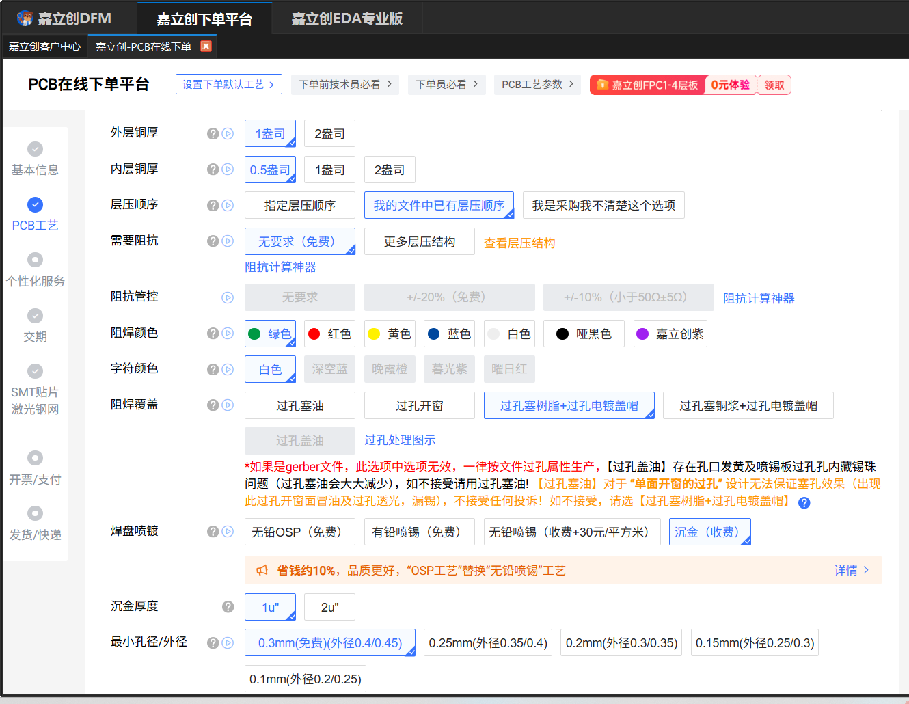

# PCB 打样下单说明

**项目**：智能温湿度传感器（方案 B）· 四层板
**下单平台**：嘉立创下单平台（PCB 在线下单）
**配套文件**：`生产文件_20261009/Gerber_2026-10-09.zip`、`CPL/CPL_SMT_智能温湿度传感器.csv`、`BOM_SMT_智能温湿度传感器.csv`、`制板说明.txt`
**首版数量**：5 片
**本文日期**：2026-10-11 初稿 / **2026-10-12 按下单页最新截图复核**

> 本文按下单页的**填写顺序**逐项给出应选值，并标出**与设计要求不符、必须手动更改**的选项。标 ⚠ 者为复核时仍存的差异项（2026-10-12 复核后仅余"层压顺序"一项，且属取叠层方式之别，见 §3.1）。
>
> **本文仅用于说明各工艺选项的含义与取舍；本工程未提交订单，亦未产生实际支付。**文中 PCB 各项金额取自下单页的快照，SMT 各项为下单页与 DFM 参数的估算值，仅供比较。

---

## 1. 基本信息区

| 项 | 应选 | 说明 |
|---|---|---|
| 板材类别 | **FR-4** | |
| 板子层数 | **4** | 叠层见《DFM 可制造性设计说明》§1.2 |
| 板子尺寸 | **4.82 × 4 CM** | 即 48.25 × 40.05 mm，与 Gerber 自动识别值一致 |
| 板子数量 | **5**（样板） | |
| HDI（盲埋孔） | **无** | 全板为通孔 |
| 产品类型 | 工业/消费/其他类电子产品 | |
| 确认生产稿 | **需要（确认 2 次，收费 3 元）** | 首版建议保留 —— 可在投产前对 CAM 做最后一次核对 |
| 拼板款数 | **1** | 只有一款板 |
| 出货方式 | 单片 | |
| 成品板厚 | **1.6 mm** | 与叠层模板 `JLC04161H-7628` 对应 |

---

## 2. 工艺区（关键部分）



上图为下单页工艺区在 **2026-10-12** 的实际状态，逐项核对见下表。**原报出的两处 ⚠ 已消除一处、改判一处**：阻焊覆盖已改为盘中孔工艺 ✅；层压顺序已选、但所选方式与本文建议不同（见 §3.1）。

| 项 | 应选 | 下单页实际状态 | 说明 |
|---|---|---|---|
| 外层铜厚 | **1 盎司** | 1 盎司 ✅ | 与叠层一致，见《DFM 可制造性设计说明》§1.2 |
| 内层铜厚 | **0.5 盎司** | 0.5 盎司 ✅ | 同上；内层为 GND / VDD 整层平面 |
| ⚠ **层压顺序** | **我的文件中已有层压顺序** | **指定层压顺序** | 必填项**已满足**（不再报红字），但取叠层的方式与建议不同，须确认所指定的叠层与 `.gbrjob` 声明一致。见 §3.1 |
| 需要阻抗 | **无要求（免费）** | 无要求 ✅ | 见 §2.1 |
| 阻抗管控 | 与上一项联动 | 灰置（随"无要求"） | |
| 阻焊颜色 | 绿色 | 绿色 ✅ | 常规色不加价 |
| 字符颜色 | 白色 | 白色 ✅ | |
| **阻焊覆盖** | **过孔塞树脂 + 过孔电镀盖帽** | 过孔塞树脂 + 过孔电镀盖帽 ✅ | **已改对** —— 这就是盘中孔工艺，U1 散热盘的 9 个孔需要它。见 §3.3 |
| 焊盘喷镀 | **沉金（收费）** | 沉金（收费）✅ | 见 §3.2 |
| 沉金厚度 | 1u"（常规档） | 1u" ✅ | 嘉立创常规档，无需加选 2u" |
| 最小孔径/外径 | **0.3 mm（免费档，外径 0.4/0.45）** | 0.3 mm（免费档）✅ | 与本板最小孔径 0.30 mm 相称；再往下（0.25 / 0.2 / 0.15 / 0.1 mm）无必要 |

### 2.1 关于阻抗（需要人拍板的一项）

Gerber 作业文件 `正式工程_方案B-job.gbrjob` 里带出 **`ImpedanceControlled: true`** —— 这是 KiCad 对"本板含阻抗控制走线"的声明，不是"要求板厂测试"。

本板只有一条射频馈线（**0.36 mm，F.Cu，参考 In1 地平面，介质 0.2104 mm，目标 50 Ω**）。《制板说明》§五 写明"**叠层未变更时无需另行调整**；如需板厂保证，可按 50 Ω ±10% 控制并提供阻抗测试条"。

| 选择 | 代价 | 适用 |
|---|---|---|
| **无要求（免费）** | 板厂不做阻抗测试，按标准叠层加工 | 与《制板说明》一致；本板用嘉立创标准叠层，理论阻抗即接近 50 Ω |
| ±10%（收费） | 加价 + 需要阻抗测试条 | 若首件射频性能不达标、需要排除板厂变量时再考虑 |

**建议：先按"无要求"下首版**；实测天线性能不理想时，改版或二版再选阻抗管控。若评审要求首版就要板厂背书，则改为 ±10%。

---

## 3. 三项必须与设计一致的工艺（逐条展开）

### 3.1 ⚠ 层压顺序（已选，但取叠层的方式与建议不同）

必填项**已满足**（下单页不再出现红字"请选择层压顺序"）。实际选中的是 **「指定层压顺序」**，而本文建议选 **「我的文件中已有层压顺序」**。

两者只差"叠层从哪里取"：

| 选项 | 叠层来源 | 评价 |
|---|---|---|
| **我的文件中已有层压顺序** | 上传包里的 `正式工程_方案B-job.gbrjob` | **建议值。** 该文件已完整声明 4 层、板厚 1.6062 mm 与逐层介质参数，板厂按它排层即可 |
| **指定层压顺序**（实际选中） | 在下单页上另行指定 | 需人工指定一套叠层，**存在与文件声明不一致的风险** |

`.gbrjob` 中随文件带出的叠层（供逐层比对）：

```
F.Cu       1 oz      0.035  mm
prepreg    7628     0.2104 mm   εr 4.4      ← 射频馈线的参考介质
In1.GND    0.5 oz   0.0152 mm
core                1.065  mm   εr 4.5
In2.PWR    0.5 oz   0.0152 mm
prepreg    7628     0.2104 mm   εr 4.4
B.Cu       1 oz      0.035  mm
```

**必须确认的一点**：所指定的叠层要与上表逐层一致，其中最关键的是**外层到 In1.GND 的介质厚度 0.2104 mm**。射频馈线（0.36 mm，F.Cu，参考 In1 地平面）的 50 Ω 正是按该厚度与 εr 4.4 核算的（见《DFM 可制造性设计说明》§1.2）；叠层一变，阻抗必须重算。

若下单页仍可改选，**建议改回「我的文件中已有层压顺序」**，让板厂直接按 `.gbrjob` 排层，少一处人工出错点；若已指定且与上表一致，则无需改动。

### 3.2 表面处理：沉金（ENIG）

**已选对 ✅。** 依据：

1. U1 为 **0.4 mm 间距 QFN**，焊盘宽仅 0.20 mm，喷锡的锡面不平整度在该间距下会带来立碑与连锡风险；
2. 本板含盘中孔，孔口需在树脂塞孔并电镀填平后保持平整，沉金的平整度优于喷锡。

沉金为收费选项。（对照：无铅 OSP 免费、有铅喷锡免费、无铅喷锡 +30 元/m²。）

**沉金厚度**：下单页选 **1u"**（嘉立创常规档），本板无金线键合、无插拔金手指，无需加选 2u"。

### 3.3 阻焊覆盖：已选「过孔塞树脂 + 过孔电镀盖帽」（盘中孔工艺）

**已按设计选定 ✅**（2026-10-12 下单页截图核对，见 §2）。

U1（nRF52810，QFN-48）的散热焊盘 pad 49 为 4.6 × 4.6 mm、网络 GND，内部有 **9 个 0.30 mm 过孔**（3 × 3 阵列）—— **设计上是盘中孔**。DFM 的"元件焊脚到孔的距离"报出 9 条 0.000 mm，指的就是这 9 个孔。

下单页的四个选项里：

| 选项 | 是不是盘中孔 |
|---|---|
| 过孔塞油 | ❌ 4 层板标配的免费工艺，只把阻焊油墨塞进孔里，**孔口仍会吸锡** |
| 过孔开窗 | ❌ |
| **过孔塞树脂 + 过孔电镀盖帽** | ✅ **就是它** —— 树脂塞孔 + 电镀填平，IPC-4761 Type VII / POFV |
| 过孔塞铜浆 + 过孔电镀盖帽 | 更贵的等效工艺，本板不需要 |

**不采用该工艺的后果**：回流时散热焊盘的锡膏会被 9 个敞口过孔吸走。按估算，钢网锡膏体积 ≈ 1.66 mm³、9 孔内容积 ≈ 1.02 mm³，**约 60% 的锡膏可能流失**，散热焊盘焊点会出现空洞。

**成本**：4 层板的盘中孔是**收费项**（嘉立创仅对 6 层及以上免费）。下单页同一配置下切换「阻焊覆盖」实测：5 片整单价由 **¥164.49** 变为 **¥265.94**（**+¥101.45**），1000 片由 **¥1569.75** 变为 **¥1954.32**（**+¥384.57**），折合约**每笔 ¥100 固定 + 每片 ¥0.29**，属每笔订单的工艺费。

> **处理状态：已确认并已落实（2026-10-12）。** 评审结论：**首版采用盘中孔工艺，不做简化** —— 即"阻焊覆盖"选 **过孔塞树脂 + 过孔电镀盖帽**，并保留沉金。**两项均已在下单页选定**（见 §2 截图）。见《DFM 检查报告与优化记录》§5.1。

---

## 4. 提交文件

**PCB 打样**：上传 `Gerber_2026-10-09.zip`（15 个文件：制板说明 + 11 图层 + `.gbrjob` + 2 钻孔）。

**SMT 贴装**：PCB 订单本身不含贴装数据，需另传

- `CPL/CPL_SMT_智能温湿度传感器.csv`（31 个位号）
- `BOM_SMT_智能温湿度传感器.csv`（23 行）

可以在 PCB 下单页直接点右下角 **「提交 pcb 订单，去下单 smt」** 进入贴装流程后再上传。

**内部件，不要上传**：`dfm.zip`、`web.zip`、`all_color_simulation_image.zip`、`丝印渲染_*.png`。

---

## 5. 下单前检查清单

> 标 ✅ 者为**已在下单页核对符合**（依据 §2 的 2026-10-12 截图）。

- [ ] 板子尺寸显示 **4.82 × 4 CM**（与 48.25 × 40.05 mm 一致）
- [ ] 层数 **4**、板厚 **1.6 mm**、数量 **5**
- [ ] 外层铜厚 1 oz、内层铜厚 0.5 oz —— **已选 ✅**
- [ ] **层压顺序** —— 已选（"指定层压顺序"），**须确认所指定叠层与 `.gbrjob` 一致**（外层介质 0.2104 mm），见 §3.1
- [ ] **阻焊覆盖 = 过孔塞树脂 + 过孔电镀盖帽**（不是"过孔塞油"）—— **已选 ✅**
- [ ] 焊盘喷镀 = **沉金**、沉金厚度 1u" —— **已选 ✅**
- [ ] 最小孔径/外径 = 0.3 mm（免费档）—— **已选 ✅**
- [ ] 需要阻抗 = 无要求（或按评审要求改 ±10%）—— **已选"无要求" ✅**
- [ ] 已上传 `Gerber_2026-10-09.zip`
- [ ] SMT 环节已上传 CPL + BOM，且**贴装位号数为 31**
- [ ] 确认生产稿 = 需要
- [ ] **U3（C5444716）的贴装方向已在贴装预览中核对**，并已随单提交《U3 贴装方向说明》（见 §6）
- [ ] **J1 的库存/交期已确认**（查询时为 0 pcs）

---

## 6. 下单时需要向嘉立创提出/确认的事项

| # | 事项 | 在哪提出 |
|---|---|---|
| 1 | **U3（C5444716，SSOP-28）的贴装方向** —— CPL 中该位号角度为 90°（坐标 131.5425, −70.000，Bottom 面），请确认贵司库内该料号的默认朝向与板上封装一致，贴装后 1 脚会落在板上 pad 1（135.670, −72.600）上。**已确认交贵司贴装审核确认，本工程不改板、不改 CPL**，随单提交《U3 贴装方向说明》 | SMT 环节的贴装预览 / 客服 |
| 2 | **U1 的 48 条 + L2 的 6 条边界告警**（DFM 自测偏差 ≈ 0 与 25~38 µm）—— **已确认首版保留现有焊盘、不改版**，无需答复板厂，如贵司审核问及可据此说明 | DFM 报告的备注 / 客服 |
| 3 | **U2 中心盘那 1 条** —— 板上用无中心盘封装，贵司库内 C2909890 为 `DFN-4-EP(1.5x1.5)`（含 EP） | 同上 |
| 4 | **J1（C51897894）** 库存 0、DFM 报 `no_package`，请确认料号与封装匹配并给出交期 | 下单页 / 客服 |
| 5 | **扩展库 14 项**的上料费金额 | 下单页自动计价 |

第 1 项的完整依据见《DFM 检查报告与优化记录》§3.2 与 §5。

---

## 7. 价格与交期（参考）

| 项 | 参考值 |
|---|---|
| PCB（4 层、含沉金，**每片**） | ≈ **¥33**（5 片整单 ¥164.49），交期 3 天 |
| SMT（5 片 × 31 位号 + 14 项扩展库上料费） | ≈ **¥976**，交期 5 天 |
| 确认生产稿 | ¥3 |
| 预估支付总价（5 片 PCB + 确认生产稿 ¥3） | **≈ ¥168**（未含 SMT 与运费） |

> **本节 PCB 金额为下单页快照值（4 层、含沉金），SMT 金额为下单页与 DFM 参数的估算值；本工程未提交订单，未产生实际支付。**实际金额以提交时的实时计价为准。SMT 金额中的工程费、钢网费、治具费、上料费等均为一次性费用，与板数无关。

---

## 8. 下单后

1. **保存订单页截图**（工艺选项区），作为"订单参数与设计要求一致"的凭证 —— **已完成**：`img/DFM-08-order-params.png`（2026-10-12）；
2. 板厂开始生产前会推送**生产稿确认**，核对板框、层数、孔径、线宽无误后再确认；
3. 首件到货后重点复查：**U1 的 0.4 mm 间距焊接质量**（是否连锡/立碑）、**U1 散热焊盘焊点空洞**、**U3 的贴装方向**。

---

**相关文档**：《DFM 检查报告与优化记录》《DFM 可制造性设计说明》《生产文件包清单》《BOM 清单与工艺说明》。
