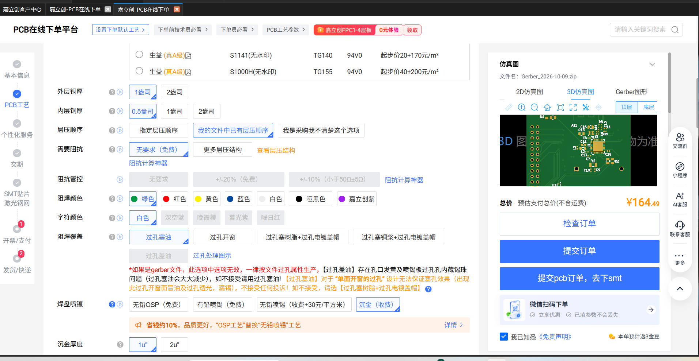
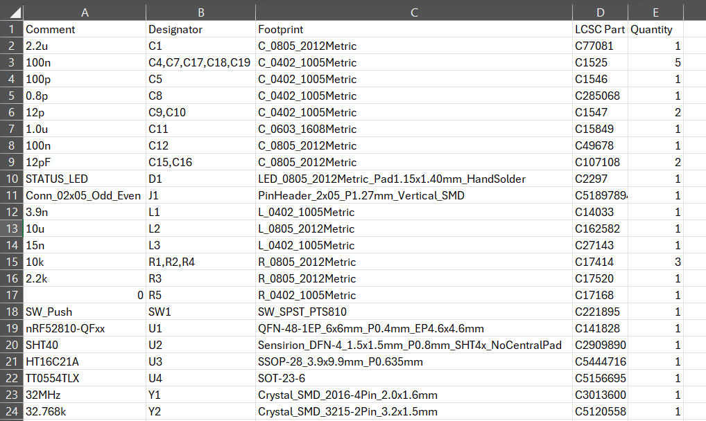
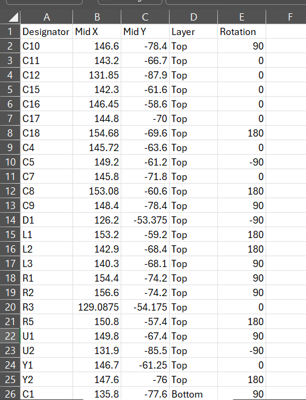
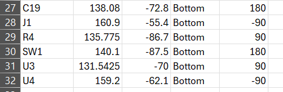
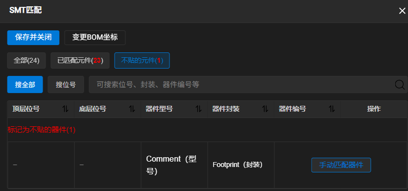
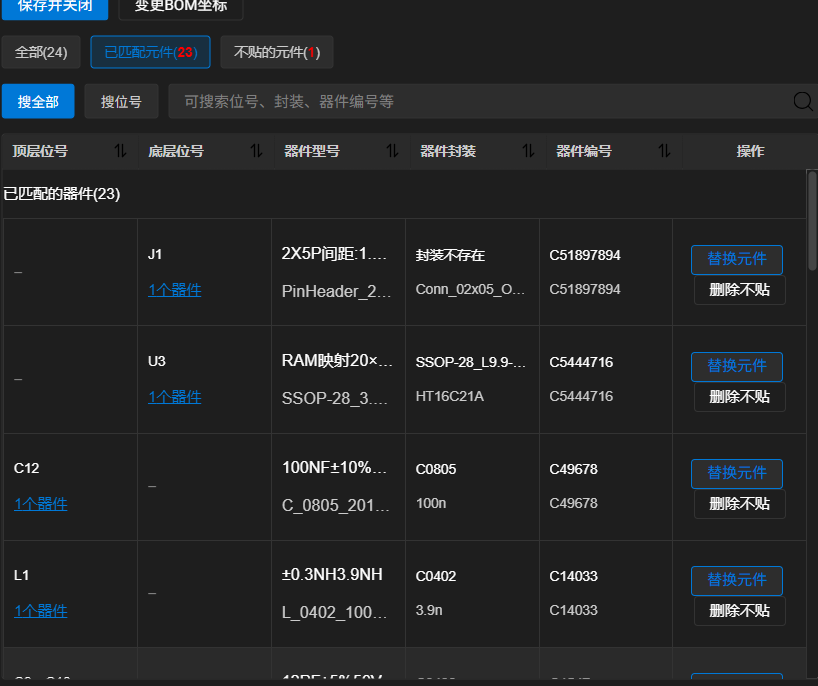

# 交付确认说明：盘中孔报价与 BOM/CPL 一致性

**项目**：智能温湿度传感器（方案 B）　**日期**：2026-10-14
**范围**：盘中孔（POFV）的工艺与报价确认；BOM 与 CPL 的一致性核对。**两项均不涉及改板。**

---

## 1. 盘中孔（POFV）工艺与报价

**工艺可行。** U1 散热盘内 9 个 0.30 mm 过孔（3 × 3，孔壁净距 1.30 mm）落在嘉立创 POFV 的适用孔径内；盘径 0.70 mm、环宽 0.20 mm（其最小要求 0.05 mm）；厚径比 1.6 / 0.30 = 5.33 : 1；表面处理沉金与其工艺兼容。下单页对应选项为「阻焊覆盖 = **过孔塞树脂 + 过孔电镀盖帽**」。

**报价**（PCB 下单页实测，同一配置下仅切换「阻焊覆盖」）：

| 数量 | 过孔塞油（免费档） | 过孔塞树脂 + 过孔电镀盖帽 | 差额 |
|---|---|---|---|
| 5 片 | ¥164.49 | ¥265.94 | **+¥101.45** |
| 1000 片 | ¥1569.75 | ¥1954.32 | **+¥384.57** |

表中为 PCB **整单总价**（不含运费）；折合每片：5 片档 ¥32.90 → ¥53.19，1000 片档 ¥1.57 → ¥1.95。两款截图为同一配置（4 层、1.6 mm、外层 1 oz / 内层 0.5 oz、沉金 1u"、最小孔径 0.3 mm、阻抗无要求），仅切换「阻焊覆盖」。

两点折算，该项加价约 **每笔 ¥100 固定 + 每片 ¥0.29**，属每笔订单的工艺费，不是单片成本。

| 5 片 | 1000 片 |
|---|---|
|  |  |
|  |  |

> 四张截图见 `img/POFV-*.png`；上排为过孔塞油、下排为盘中孔工艺。

**下单时需落实两点：**

1. 下单页原文注明「**如果是 gerber 文件，此选项中选项无效，一律按文件过孔属性生产**」，并将【过孔塞树脂 + 过孔电镀盖帽】列为该工艺的对应选项。本单以 Gerber 提交，因此除在页面选定该选项外，工艺要求已写入随包提交的《制板说明.txt》§三，下单时还需在订单备注中重申，并保留「确认生产稿」。
2. 该选项在嘉立创为**整板生效**。本板只有 U1 散热盘那 9 个孔需要按此工艺处理，其余过孔按常规即可。

---

## 2. BOM 与 CPL 一致性

**一致，不涉及改板。**

- 位号集合完全相同：BOM 23 行 / 31 个贴装位号，CPL 31 行；仅 BOM 有 0 个、仅 CPL 有 0 个
- CPL 的 31 个位号逐一都能对到 BOM 中的所在行（31 / 31）
- BOM 每行的 Quantity 与该行 Designator 的个数一致（5 / 5、2 / 2、1 / 1 ……）
- 不贴装的 **AE1、LCD1、BT1、C6、C13、C14** 六项：两份文件中均不出现，符合预期

**BOM 原件**（表头 + 23 行数据）

**CPL 原件**（表头 + 31 行数据）

**嘉立创 SMT 匹配页**（同批上传 BOM + CPL 后的匹配结果）

- 已匹配元件 **23**，与 BOM 的 23 行一一对应
- 页面另显示「全部 24 / 不贴的元件 1」：多出的那一条为 CSV 的**表头行**被平台当作一个元件条目（该条目无位号），属平台识别的显示问题，与两份文件本身无关

---

**依据文件**：`生产文件_20261009/BOM_SMT_智能温湿度传感器.csv`、`生产文件_20261009/CPL/CPL_SMT_智能温湿度传感器.csv`、`生产文件_20261009/Gerber_2026-10-09.zip`（钻孔文件）、嘉立创下单平台 SMT 匹配页。
